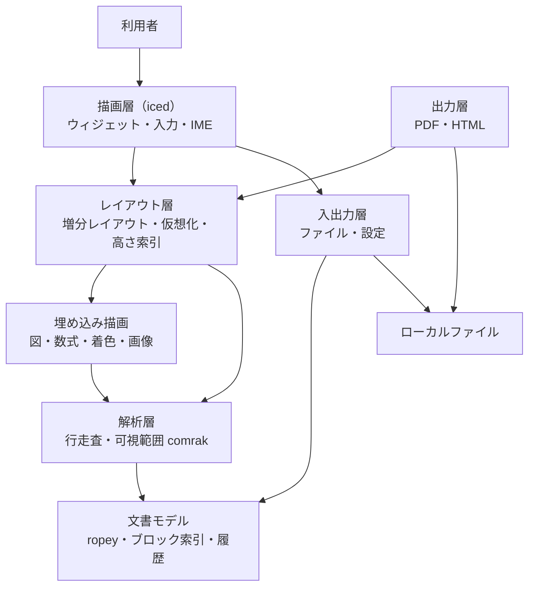
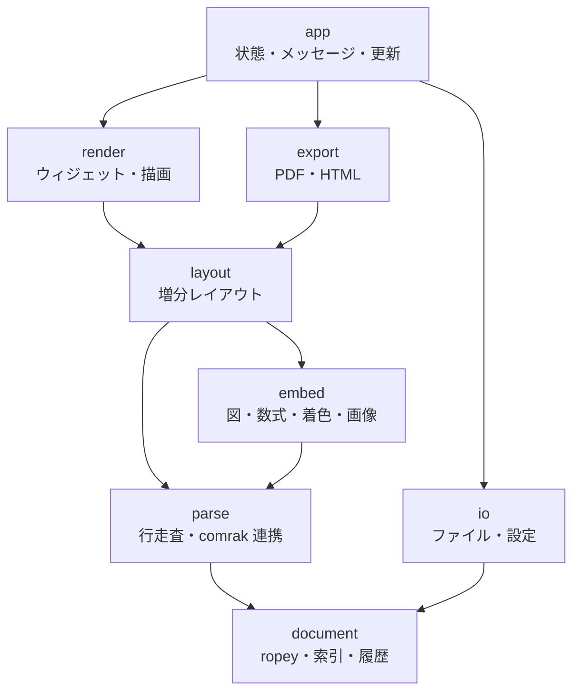
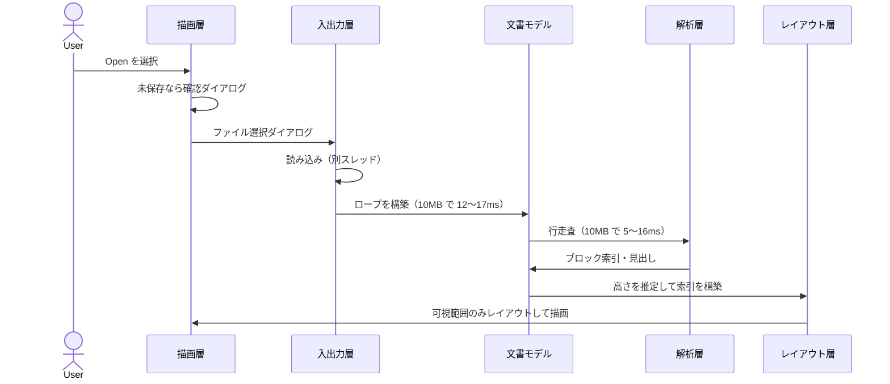
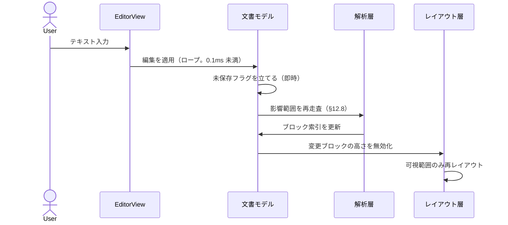
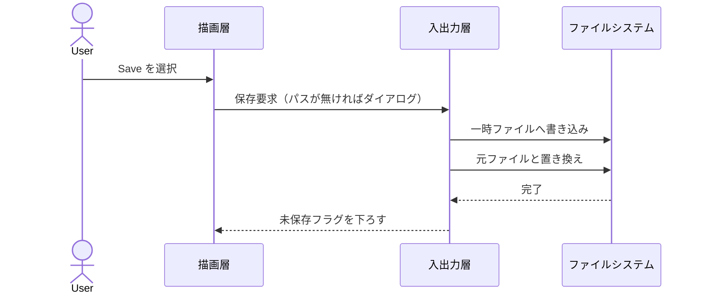
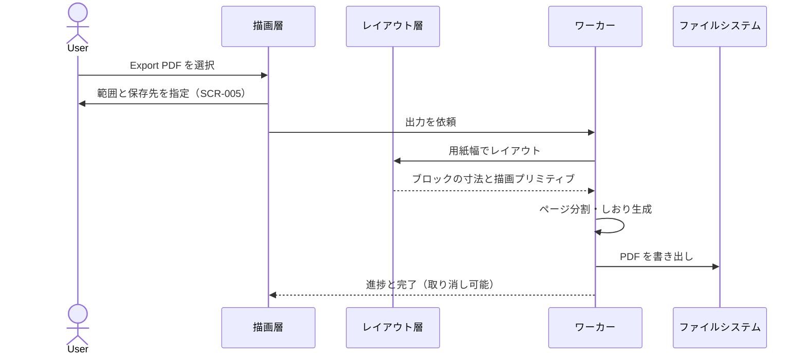

# Markdown Viewer 基本設計書

|項目|内容|
|---|---|
|文書名|Markdown Viewer 基本設計書|
|対象システム|Markdown Viewer v2.0.0（v2.1.0 の追加は §28）|
|対象フェーズ|基本設計|
|前提|受託開発 RFP 前提|
|作成日|2026-07-31|
|改訂日|2026-10-08|
|版数|**v3.1**|
|関連文書|[技術選定書](Markdown%20Viewer技術選定書.md) v1.7 ／ [詳細設計書](Markdown%20Viewer詳細設計書.md) v0.1 ／ [v2.1.0 の要件定義書](../doc/v2.1.0の要件定義書.md)|

---

> **【本書の版について】**
>
> 本書は v2.0 で **v2.0.0（Rust 単一言語・WebView なし）の基本設計へ全面改訂**した。
> v1 系（Tauri + React + WebView2）の基本設計は **git の履歴**（v1.7 まで）を参照する。
>
> **節番号は v1 の構成を維持している。** 他文書からの参照（例「基本設計書 §23.2」）を
> 壊さないためである。内容は v2.0.0 のものに置き換わっている。

---

## 1. はじめに

### 1.1 本書の目的

本書は、Windows / macOS / Linux で動作する Markdown アプリケーション「Markdown Viewer」
v2.0.0 の基本設計を定義するものである。

本書では以下を設計対象とする。

- アプリケーション全体構成
- 画面設計
- 文書モデルと解析設計
- **レイアウト・描画設計**（v2.0.0 の中心）
- 状態管理設計
- ファイル操作設計
- PDF / HTML エクスポート設計
- エラー処理設計
- 非機能設計

技術の選定理由（なぜ Rust か、なぜ iced か、なぜ tree-sitter を使わないか）は
本書では扱わない。[技術選定書](Markdown%20Viewer技術選定書.md)に
実測とともに記録してある。

### 1.2 システムの目的

Markdown Viewer は、Obsidian や VS Code よりも軽量で、Markdown 文書の閲覧・軽微な編集に
集中できるデスクトップアプリケーションを提供することを目的とする。

主な目的は以下である。

- 社内ドキュメントを軽量に閲覧できること
- Markdown の簡易編集ができること
- GFM、Mermaid、KaTeX、画像を表示できること
- **Electron / WebView ベースのアプリよりも軽量であること**
- Windows / macOS / Linux で利用できること

### 1.3 v1 からの変更の要点

v1（1.0.1）は目的の大半を満たしたが、**WebView2 に依存することに起因する 3 つの限界**が
あった。v2.0.0 はこれを解消するための全面再実装である。

|v1 の限界|v1 実測|v2.0.0 での解決|
|---|---|---|
|メモリが目標を超える|WorkingSet 580MB|**WebView を持たない。** 10MB 文書で 157〜185MB（PoC 実測）|
|PDF 出力が遅い|283 ページで 10.70 秒|**自前生成。** 同条件 0.73 秒（PoC 実測）|
|扱える文書が小さい|上限 300KB|**10MB。** 全文を触らない構造へ（§12・§16）|

副次的に、**PDF のしおりが全 OS で出せる**ようになり（v1 は Windows 限定）、
**HTML サニタイズ・CSP・asset プロトコルの設計が不要**になった（HTML を描画しないため）。

一方で失うものもある。**起動時間は v1（283ms）より遅くなる**（§20.3）。
Mermaid の見た目は v1 と一致しない（§16.12）。

---

## 2. 前提条件

### 2.1 開発前提

|項目|内容|
|---|---|
|アプリ種別|デスクトップアプリケーション|
|**実装言語**|**Rust 単一言語**（フロントエンド言語を持たない）|
|**UI**|**iced 0.14**（wgpu 描画 / cosmic-text 整形）|
|**描画方式**|**WebView を持たず、自前の文書レイアウトエンジンを実装する**|
|テキストバッファ|ropey|
|Markdown 解析|comrak（可視範囲と出力）＋ 自前の行走査（構造）|
|図表レンダリング|merman + resvg|
|数式レンダリング|latex-rust|
|コード着色|syntect|
|PDF 生成|krilla|
|フォント|**同梱**（PlemolJP / IBM Plex Sans JP）|
|対象 OS|Windows / macOS / Linux|
|ネットワーク|不要。完全オフライン動作|
|配布形式|**単一ファイルの実行形式**|

各選定の根拠は技術選定書 §2（DEC-201〜211）を参照。

### 2.2 利用形態

- 社内配布
- 個人利用
- ローカルファイル利用
- 1 インスタンス 1 ファイル
- 複数タブなし
- ワークスペース管理なし
- 最近開いたファイル履歴なし

---

## 3. スコープ

### 3.1 対象スコープ

#### 機能（v1 から引き継ぐ）

- Markdown ファイルを開く
- 新規文書を作成する
- コマンドライン引数・ファイル関連付けから開く
- Markdown ファイルを保存する／名前を付けて保存する
- ドラッグ＆ドロップでファイルを開く
- Markdown を編集する（Undo / Redo・文書内検索・行番号）
- Edit / Preview / Split の画面切替
- ライブプレビュー
- GFM 表示・Mermaid 表示・KaTeX 表示・画像表示
- TOC 左サイドバー表示
- Light / Dark / System テーマ
- ズーム
- 未保存変更警告
- PDF エクスポート
- HTML エクスポート

#### v2.0.0 で新たに満たすもの

|項目|内容|
|---|---|
|**対象サイズ**|**10MB**（v1 は 300KB）|
|**PDF のしおり**|**全 OS**（v1 は Windows のみ）|
|**PDF の保存先指定**|**アプリから直接指定する**（v1 は OS の印刷ダイアログ経由）|
|**PDF の出力範囲指定**|文書全体／見出し単位／ページ指定（§17.11）|
|**クラッシュ時の未保存内容の退避**|§18.3|

### 3.2 対象外スコープ

- Git 連携／クラウド同期／AI 支援／Wiki 管理／ノート管理
- 複数タブ／複数ファイル同時表示／最近開いたファイル履歴
- ワークスペース機能／プラグイン機構／共同編集／多言語対応
- 自動 E2E テスト
- **HTML の埋め込み表示**（§3.3）
- **起動制御**（ログオンユーザー名と設定値で起動を止める運用上の制御）。仕様書
  （[起動制御機能の仕様書](../doc/起動制御機能の仕様書.md)）はあるが、**当面実装しない**（2026-10-16 決定）

### 3.3 v1 から外す機能

|機能|v1|v2.0.0|理由|
|---|---|---|---|
|**生 HTML の埋め込み表示**|サニタイズして表示|**表示しない**（原文をそのまま出す）|HTML を描画するエンジンを持たないため。表示するには HTML/CSS エンジンが必要になり、WebView を捨てた前提と矛盾する|

**これは機能の後退である。** v1 で `<details>` や `<br>` を使っている社内文書は
表示が変わる。影響範囲は §26 の移行時に確認する。

### 3.4 制約付きで提供する機能

|機能|制約|
|---|---|
|数式の `\text{}`|**日本語を入れられない**（技術選定書 OPEN-211）|
|erDiagram|**ラベルが表示されない**。当面はコードブロック表示に退避（技術選定書 OPEN-210）|
|エディタの折り返し|**v2.0.0 では提供しない**（横スクロール。§15.2）。**v2.2.0 から 512 KB 以下の文書に限って設定で折り返す**（§29）|

---

## 4. システム全体構成

### 4.1 論理構成



**v1 との決定的な違いは、レイアウト層と描画層を自前で持つことである。**
v1 ではこの 2 層を WebView2 が担っていた。

### 4.2 レイヤー構成

|レイヤー|役割|
|---|---|
|描画層|iced によるウィジェット描画、入力受付、IME|
|レイアウト層|ブロックの寸法決定、仮想化、高さ索引、キャッシュ|
|埋め込み描画|図・数式・コード着色・画像のラスタライズ|
|解析層|行走査による構造抽出、可視範囲の Markdown 解析|
|文書モデル|本文の保持、ブロック索引、編集履歴|
|出力層|PDF / HTML の生成|
|入出力層|ファイル読み書き、設定の永続化、OS 連携|

**上位層は下位層にのみ依存する。** とくに**レイアウト層は描画層に依存しない**。
PDF 出力が描画層を介さずレイアウト結果を使えるようにするためで、
これが画面と PDF の見た目を一致させる仕組みになる（§17.3）。

### 4.3 スレッド構成

|スレッド|担当|理由|
|---|---|---|
|UI スレッド|入力受付、レイアウト、描画|iced の制約。レイアウトは可視範囲のみで数 ms に収まる（§16.6）|
|ワーカープール|**図・数式の描画、コード着色の初回、画像デコード、PDF / HTML 出力、検索**|1 件あたり数百 ms〜秒単位になり得るため UI を止めない|
|ファイル I/O|読み込み・保存|10MB の読み込みは数十 ms だが、遅い共有ドライブを考慮して外に出す|

**ワーカーの結果は「完成した描画物」としてレイアウト層へ返す。**
到着するまでは寸法が確定したプレースホルダを描く（§16.5）。

---

## 5. 技術スタック設計

### 5.1 採用ライブラリ

|分類|採用|用途|
|---|---|---|
|UI ツールキット|iced 0.14|ウィンドウ・ウィジェット・入力・IME|
|GPU 描画|wgpu（iced 経由）|描画|
|テキスト整形|cosmic-text（iced 経由）|字形の配置・複雑テキスト|
|テキストバッファ|ropey|10MB の本文保持と編集|
|Markdown 解析|comrak|可視範囲の解析と出力用の全文解析|
|構造抽出|**自前の行走査**|ブロック境界・見出し。§12.6|
|コード着色|syntect 5|フェンス内の着色|
|図|merman 0.9|Mermaid → SVG（背景は白で塗るよう頼む）|
|数式|latex-rust 2.1|LaTeX → SVG（パス出力）|
|SVG 描画|resvg 0.45|図・数式のラスタライズ|
|PDF 生成|krilla 0.8|PDF の組版と書き出し|

### 5.2 同梱フォント

|用途|フォント|ウェイト|サイズ|
|---|---|---|---|
|エディタ・コードブロック|PlemolJP|Regular / Bold|10.67MB|
|本文・見出し・UI|IBM Plex Sans JP（hinted）|Regular / Bold|10.89MB|
|数式|STIX Two Math|Regular|0.82MB（latex-rust 同梱）|

**システムフォントへのフォールバックを行わない。** 漢字統合により中国語の字形が
拾われるため（技術選定書 §6.5.5）。詳細は §16.11。

### 5.3 外部プロセス・ランタイム

**持たない。** Node.js・WebView2 ランタイム・.NET など、実行時に別途必要な
ものは一切要求しない。

---

## 6. 画面設計

### 6.1 画面一覧

|画面 ID|画面名|概要|
|---|---|---|
|SCR-001|メイン画面|Markdown の編集・閲覧を行う主画面|
|SCR-002|ファイルオープンダイアログ|Markdown ファイル選択（OS 標準）|
|SCR-003|名前を付けて保存ダイアログ|保存先指定（OS 標準）|
|SCR-004|未保存変更確認ダイアログ|未保存時の離脱確認|
|SCR-005|PDF エクスポートダイアログ|**出力範囲・保存先の指定**（§17.11）|
|SCR-006|エラーダイアログ|ファイル読込失敗等の通知|
|**SCR-007**|**進捗ダイアログ**|**PDF / HTML 出力の進捗表示と取り消し**（§17.10）|

SCR-002 / SCR-003 は OS 標準のダイアログを使う。それ以外はアプリが自前で描画する。

---

## 7. SCR-001 メイン画面設計

### 7.1 基本レイアウト

```text
┌──────────────────────────────────────────────┐
│ Menu Bar                                     │
├──────────────────────────────────────────────┤
│ Toolbar                                      │
│ [New] [Open] [Save] [Save As]                │
│ [Edit] [Preview] [Split] [TOC] [Sync] [Theme]│
├───────────────┬──────────────────────────────┤
│ TOC Sidebar   │ Main Content                 │
│ collapsible   │ Editor / Preview / Split     │
│ resizable     │ resizable (Split)            │
├───────────────┴──────────────────────────────┤
│ Status Bar                                   │
└──────────────────────────────────────────────┘
```

v1 のレイアウトを踏襲する。TOC サイドバーの幅と Split の比率は可変とする。

- 境界をドラッグして変更する
- 境界にフォーカスした状態の矢印キーでも変更する
- 境界のダブルクリックで既定値へ戻す
- 変更後の値は設定として永続化する（§13.4 の `tocWidth` / `splitRatio`）

**幅の変更はレイアウトの再計算を伴う**（折り返しが変わるため）。
連続操作中は再計算を抑制する（§16.9）。

### 7.2 メニュー構成

v2.1.0 の時点の構成（2026-10-08 に実装と突き合わせた）に、v2.3.0 で足した項目（「v2.3.0」と書いたもの。§30）を
加えた。打鍵は既定のもので、
**設定画面の「キー割り当て」で変えられる**（v2.1.0 R-10）。打鍵の無い項目にも割り当てられる。

```text
ファイル(F)
 ├ 新規                       Ctrl + N
 ├ 新しいウィンドウ           Ctrl + Shift + N   （v2.1.0 R-09。別のプロセスで開く）
 ├ 開く…                      Ctrl + O
 ├ 新しいウィンドウで開く…    Ctrl + Alt + O
 ├ アプリ内で開く…            （自前のファイル選択）
 ├ ファイルを比べる…          （v2.3.0 R-02。diff の画面）
 ├ アプリ内で選んで比べる…    （v2.3.0 R-02）
 ├ 保存してある元と比べる     （v2.3.0 R-02）
 ├ パッチを当てる…            （v2.3.0 R-04）
 ├ 最近使ったファイル ▸        （折りたたみ。末尾に「一覧を消す」）
 ├ 上書き保存                 Ctrl + S
 ├ 名前を付けて保存…          Ctrl + Shift + S
 ├ BOM を付けて保存
 ├ 文字コード・改行コード…    （1 つのダイアログで開き直す・保存する。v2.1.0 R-04）
 ├ PDF に出力…
 ├ HTML に出力…
 ├ 設定…                      Ctrl + ,           （v2.1.0 R-03）
 └ 終了                       Alt + F4

編集(E)
 ├ 取り消し / やり直し        Ctrl + Z / Ctrl + Y（Ctrl + Shift + Z）
 ├ 切り取り / コピー / 貼り付け / すべて選択
 ├ 行の複製 / 行の削除 / 行の連結   Ctrl + D / Ctrl + L / Ctrl + J
 ├ 字下げ / 字下げを戻す      Tab / Shift + Tab
 ├ 行コメントの切替           Ctrl + /           （v2.1.0 R-06）
 ├ ブロックコメントの切替     Shift + Alt + A
 ├ 書式 ▸                     太字・斜体・インラインコード・リンク
 ├ 表 ▸                       表を整形（Shift + Alt + F）・表に行を足す・表に列を足す（v2.1.0 R-16）
 ├ 選んだ範囲を変換 ▸         大文字・小文字・半角・全角・ひらがな・カタカナ・タブと空白
 ├ 日付・時刻を挿入 ▸
 ├ 検索・置換…                Ctrl + F
 ├ スニペットを入れる…        Ctrl + Shift + J   （v2.3.0 R-08）
 ├ 目次を入れる / 目次を作り直す            （v2.3.0 R-10）
 ├ 見出しに番号を振る / 見出しの番号を外す  （v2.3.0 R-10）
 └ 選んだ文字に印を付ける（目 grep）        （v2.3.0 R-05）

表示(V)
 ├ Markdown の検査の一覧      （v2.3.0 R-11）
 ├ 編集 / プレビュー / 分割
 ├ 目次
 ├ スクロール同期             （分割のときだけ）
 ├ 空白・タブ・改行を表示
 ├ 拡大 / 縮小 / 等倍に戻す   Ctrl + + / Ctrl + - / Ctrl + 0
 ├ 常に最前面に表示           （v2.1.0 R-02）
 ├ 集中モード                 F11                （v2.3.0 R-13。Esc でも出る）
 └ 読み取り専用               （v2.1.3）

移動(G)                         （v2.1.0 R-07・R-18〜R-20）
 ├ 定義へ移動 / 型定義へ / 宣言へ / 実装へ   F12 / Ctrl + Shift + F12 / Ctrl + F12 / Alt + F12
 ├ 参照を探す                 Shift + F12
 ├ 対応する括弧へ / 閉じ括弧へ移動   Ctrl + ] / Ctrl + Shift + \
 ├ 指定行へジャンプ…          Ctrl + G
 ├ 前の見出しへ / 次の見出しへ   Ctrl + ↑ / Ctrl + ↓
 ├ 見出しへ移動…              Ctrl + Shift + O
 ├ リンクを開く               Ctrl + Enter
 ├ リンク切れを検査
 ├ この見出しを畳む / 開く    Ctrl + Shift + [ / Ctrl + Shift + ]
 └ すべて畳む / すべて開く

ヘルプ(H)
 └ このアプリについて…
```

> **v2.1.0 でメニューから設定画面へ移したもの**（R-03）: 外観（明るい・暗い・OS に合わせる）、
> タブ幅、怪しい文字の強調、異常終了に備えて退避する。
> 文字コードの 3 つの折りたたみ（指定して開き直す・指定して保存・改行コードを指定して保存）は
> 「文字コード・改行コード…」1 つにまとめた（R-04）。

#### メニューバーの実装方式

|OS|方式|理由|
|---|---|---|
|macOS|**OS ネイティブ**（画面上端）|macOS の作法に合わせる。アプリ内に描くと不自然になる|
|Windows / Linux|**自前描画**|ウィンドウ内に置くため。自前描画ならテーマとも一致する|

**v1 で発生した次の問題は、v2.0.0 では構造的に起きない。**

|v1 の問題|v2.0.0|
|---|---|
|Windows でネイティブメニューのアクセラレータが発火しない|自前描画のため**アプリが直接キーを受ける**|
|`Ctrl + P` が WebView（Chromium）の印刷機能と衝突する|**WebView が無い**|

#### キーバインドの注意（v1 から引き継ぐ）

- **ズームは物理キー位置ではなく入力文字で判定する。** `Ctrl` + `+` / `-` を
  入力文字（`+` `=` `-`）で判定する。物理キー位置で指定すると JIS 配列で入力できない
- 拡大の `=` は **Shift 併用時を除外**する（JIS では `Shift` + `-` が `=` になるため）
- `Zoom Reset`（`Ctrl + 0`）は数字キーの物理位置が配列によらず一致するため、そのまま扱う
- `Exit` は OS 標準の終了項目ではなく独自項目とする（未保存確認を挟むため）
- **割り当てられるのは `Ctrl`・`Alt`・F キーを含む打鍵だけ**（v2.1.0 R-10）。修飾キーの無い文字・`Tab`・`Enter` などはエディタが直に扱う

#### 割り当て文字（アクセスキー）

Windows の作法に合わせ、**`ファイル(F)` のように出して割り当て文字へ
下線を引く**。

|操作|効き方|
|---|---|
|`Alt` + 文字|その見出しを開く（もう一度で閉じる）|
|開いている間に文字|その項目を選ぶ。折りたたみなら開閉する|
|`Esc`|閉じる|

- **同じメニューの中で重ねない。** 重ねると先に見つかったほうしか選べず、
  押しても何も起きないように見える（試験で見ている）
- **押せない項目は選ばない。** 押せるように見えて何も起きないほうが分かりにくい
- メニューを開いている間は**本文へ入力しない**（割り当て文字が本文に入る）
- 折りたたみの中身（文字コード・変換・最近使ったファイルなど）には
  割り当てを置かない。**数が変わる並び**なので、固定の文字を約束できない

### 7.3 ツールバー（**置かない**）

v2.0.0 では**ツールバーを持たない**（利用者の要望）。

同じ操作がメニュー（§7.2）に並んでおり、**二重に持つと片方だけ直して
食い違う**。実際、v1 の頃からボタンの有効・無効の条件がメニューと
ずれていた。

打鍵はキーバインド（詳細設計書 §8.3）で足りる。

### 7.4 ステータスバー

|表示項目|内容|
|---|---|
|ファイル名|現在開いているファイル名|
|保存状態|Saved / Unsaved|
|カーソル位置|Ln / Col|
|エンコーディング|**UTF-8 と、BOM の有無・改行コード**。開いた形をそのまま保存するため（§19.4）、いま何を保っているかを出す。**押すと文字コード・改行コードのダイアログが開く**（v2.1.0 R-04）|
|表示モード|Edit / Preview / Split|
|**文書サイズ**|**バイト数**。10MB 級を扱うため常時表示する|
|一時メッセージ|**本文の上の帯に出す**（ステータスバーではない）。出力先のような「次に開きたいもの」を押せるようにするため、消えるまでの間に操作できる必要がある（§10.25）|

> **v2.2.0**: 並べ方は**書式で変えられる**（設定 → 外観。`{name}` `{state}` `{line}` などの差し込み口。§29）。
> 上の表は**既定の書式**の中身である。窓の題名も同じ仕組みで、既定は「読み取り専用の印・ファイル名・
> 未保存の印・アプリ名」。書式から `{encoding}` を外すと、文字コードを押して選ぶ所も無くなる

**計測値は出さない。** P1〜P3 では 1 打鍵の ms・レイアウトの命中率・IME の
記録をここに出していたが、実装を確かめるための表示であり、使う人には要らない。
計測は `--bench-*` で外から起こす。

---

## 8. 表示モード設計

### 8.1 Edit Mode

Markdown 編集領域のみを表示する。

#### 主な機能

- Markdown 編集
- 行番号表示
- Undo / Redo
- 文書内検索
- コピー＆ペースト
- カーソル位置表示
- 範囲選択（マウスのドラッグ・ダブルクリック・キーボード）
- **日本語入力（IME）**（§15.3）

#### 範囲選択と単語選択

|項目|内容|
|---|---|
|強調|選択部分に選択色を敷く。**アクティブ行の背景は選択の背面に描く**|
|ダブルクリック|**単語ひとつ分**を選ぶ。日本語も単語単位で区切る（§15.4）|
|3 回以上のクリック|行（段落）全体を選ぶ|
|区切り文字|空白・句読点・記号の上では単語補正を行わない|

#### 折り返し

**v2.0.0 では行の折り返しを提供しない**（横スクロール）。

理由は §15.2 に記す。v1（CodeMirror）は折り返していたため、**これは機能の後退である。**

### 8.2 Preview Mode

レイアウト結果のみを表示する。

#### 主な機能

- GFM 表示・Mermaid 表示・KaTeX 表示・画像表示
- リンククリック
- 見出しジャンプ

リンクの扱いは次のとおり。

|リンク|動作|
|---|---|
|`#見出し`|文書内の該当見出しへスクロールする|
|`http` / `https`|OS の既定ブラウザーで開く|
|上記以外|開けない旨をダイアログで通知する|

#### プレビュー内検索（`Ctrl + F`）

Preview Mode では**レイアウト結果のテキストを対象とした検索**を行う。
表示モードは切り替えない。

|項目|内容|
|---|---|
|対象|プレビューに**表示されている文字**（Markdown の記法は含まない）|
|一致|大文字小文字を区別しない。重なる一致は数えない|
|強調|一致箇所を強調し、現在位置は別色にする|
|操作|検索欄で `Enter` は次へ・`Shift + Enter` は前へ、置換欄で `Enter` は 1 件置換、`Esc` で閉じる。前後移動は端で折り返す|
|件数|`3/12` の形式で表示する。0 件のときは「見つかりません」|
|**検索範囲**|**文書全体**。可視範囲に限らない|
|**実行場所**|**ワーカー**。10MB を走査するため、見つかった順に結果を返す|
|一覧|バーの下に一致箇所を一覧表示する。各行に**直近の見出し**と**前後の文脈**（前後 24 文字）を出す。クリックでその箇所へ移動する|
|一覧の高さ|プレビュー高さの 30% を上限とし、超えたら一覧内でスクロールする|

配置はプレビュー領域の上端に固定する。PDF 出力には含めない。

> **v1 との差**: v1 は DOM に対する CSS Custom Highlight API で強調していた。
> v2.0.0 は DOM を持たないため、**レイアウト結果のテキスト範囲に対して
> 強調矩形を重ねて描く**。

エディタの検索（Edit / Split Mode）は **Markdown の原文**が対象であり、
両者は目的が異なる。

#### 置換（v2.0.0 で追加。利用者の要望）

|項目|内容|
|---|---|
|対象|**原文**（プレビュー側は置換しない）|
|切り替え|**大文字小文字の区別**（既定は区別しない）と**正規表現**|
|操作|`置換`（いまの 1 件を置き換えて次へ）／`すべて置換`|
|後方参照|正規表現のときだけ `$1` `${name}` を展開する。そのままの文字のときは `$` も文字として入る|
|取り消し|**`すべて置換` は 1 回の取り消しで元へ戻る**（§4.7 に 1 件として積む）|
|誤り|正規表現の書き方が誤っていたら、**理由を件数の代わりに出す**|

**正規表現は後戻りしない実装（`regex`）を使う。** 先読みは書けないが、
10MB の文書に対して最悪時間が読める。`fancy-regex`（コード着色が使う）は
書き方次第で事実上終わらない照合になりうるため、利用者が書く場所には使わない。

**`すべて置換` は画面の一覧（2,000 件）に縛られない。** 一覧は表示の都合で
打ち切っているが、「すべて」と言われたら全部が対象である。

### 8.3 Split Mode

編集領域とプレビュー領域を左右に表示する。

#### 主な機能

- 編集とプレビューの同時表示
- 入力ごとの即時プレビュー反映
- エディタとプレビューのスクロール同期（設定で ON / OFF。既定は ON）
- エディタとプレビューの幅の比率を可変とする（§7.1）

スクロール同期の仕組みは §16.14 に記す。**v1 の `data-line` 属性に相当するものは
ブロック索引が担う。**

---

## 9. TOC 設計

### 9.1 配置

TOC は画面左側の折りたたみ可能なサイドバーとして配置する。サイドバーの幅は可変とする。

### 9.2 対象見出し

H1 から H6。

### 9.3 機能

|機能|内容|
|---|---|
|見出し一覧生成|**行走査の結果から作る**（§12.6）。Markdown の解析を要しない|
|階層表示|H1 から H6 の階層を表現|
|折りたたみ|サイドバーの表示・非表示。あわせて、子を持つ項目を個別に折りたたむ|
|ジャンプ|見出しクリックで該当位置へスクロール（アンカーを設定する。§16.7）|
|状態保持|TOC の開閉状態を設定として保持|
|絞り込み|上の入力欄に打った文字を含む見出しだけを出す（v2.1.0 R-18）|

### 9.4 大きい文書での扱い

**10MB の文書では見出しが 16,557 件になる**（技術選定書 §8.3 の実測）。

- **TOC も仮想化する。** 全件をウィジェット化しない
- 折りたたみ状態は**見出しのパス**で保持する。行番号で持つと編集でずれる
- 生成は行走査に含まれるため、専用の再生成処理を持たない（§12.8）

### 9.5 TOC 生成タイミング

- ファイル読込時
- Markdown 編集時（行走査の差分更新に伴う）
- 表示モード切替時は**再生成しない**（内容が変わらないため）

文書サイズによる打ち切りは行わない。

---

## 10. テーマ設計

### 10.1 テーマ種別

|テーマ|説明|
|---|---|
|Light|常にライトテーマを適用|
|Dark|常にダークテーマを適用|
|System|OS のテーマ設定に追従|
|iced の配色（v2.1.0 R-13）|Dracula・Nord・Solarized・Gruvbox・Catppuccin・Tokyo Night など、iced が持つもの|

**選ぶ場所は設定画面の「外観」**（v2.1.0 で表示メニューから移した）。
本文・選択・検索の色は、配色の文字色から作る（選択は 28%・一致は 18% の濃さで重ねる）。

### 10.2 テーマ適用範囲

アプリ全体、メニューバー、ツールバー、TOC、エディタ、プレビュー、ステータスバー、
ダイアログ、コードハイライト。

### 10.3 実装方針

**色はレイアウト結果に持たせず、描画時に解決する。**

テーマを切り替えてもレイアウトは変わらないため、**レイアウトキャッシュを捨てずに済む**
（§16.8）。10MB 文書でテーマを切り替えるたびに再レイアウトが走ると実用にならない。

**コード着色も同じ扱いにする。** syntect から色ではなく**スコープを取り出して
役割へ写す**ため（§16.13）、着色結果にテーマは含まれない。
したがって**テーマを切り替えても着色キャッシュを破棄しなくてよい**。

> v2.0.0 の実装前は「着色結果にテーマが含まれるため破棄する」としていたが、
> 役割で持つ設計に改めたことで不要になった（詳細設計書 §10.9）。

### 10.4 System テーマ時の動作

- アプリ起動時に OS テーマを反映する
- OS テーマ変更イベントを検知可能な場合は即時反映する
- 検知できない環境では次回起動時に反映する

---

## 11. 内部構成設計

### 11.1 モジュール構成



### 11.2 モジュール一覧

|モジュール|責務|
|---|---|
|`app`|アプリ状態、メッセージ処理、初期化|
|`render`|ウィジェットと描画。iced に依存する唯一の層|
|`layout`|ブロックの寸法決定、仮想化、高さ索引、キャッシュ|
|`embed`|図・数式・コード着色・画像のラスタライズ|
|`parse`|行走査と comrak 連携|
|`document`|本文（ropey）、ブロック索引、編集履歴|
|`export`|PDF / HTML 生成|
|`io`|ファイル読み書き、設定の永続化、OS 連携|

**`layout` は `render` に依存しない**（§4.2）。

### 11.3 自前実装するウィジェット

既製のウィジェットは 10MB に耐えないため、次の 3 つは自前で実装する
（技術選定書 §6 の PoC で確認）。

|ウィジェット|役割|
|---|---|
|`EditorView`|等幅・行単位・仮想化。IME を受ける（§15）|
|`PreviewView`|レイアウト結果を描く。可変高さ・仮想化（§16）|
|`TocView`|見出しの階層表示。仮想化（§9.4）|

ツールバー・ステータスバー・ダイアログ・分割バー・メニュー（自前描画の OS）は
iced の標準ウィジェットで足りる。

---

## 12. 文書モデルと解析設計

### 12.1 文書モデル

```text
Document
 ├─ text: Rope                  本文（ropey）
 ├─ blocks: BlockIndex          ブロック索引（§12.2）
 ├─ history: History            undo / redo（§12.4）
 └─ meta: DocumentMeta          パス・BOM の有無・改行コード・未保存フラグ
```

**文字列全体を作り直す操作を設けない。** 10MB の `to_string()` は数十 ms かかり、
1 打鍵ごとに実行できる値ではない。解析・描画・出力はすべてロープから
必要な範囲だけを読む。

### 12.2 ブロック索引

文書を「ブロック」の列として持つ。ブロックは**空行で区切られた塊**、および
コードフェンスで囲まれた塊である。

```text
BlockIndex
 ├─ entries: Vec<Block>
 └─ heights: FenwickTree<f32>   高さの累積和（§16.3）

Block
 ├─ start_byte / end_byte: usize
 ├─ start_line: usize
 ├─ kind: BlockKind             Paragraph | Heading(u8) | Code{lang} | Table
 │                              | List | Quote | Image | Mermaid | Math | Rule
 ├─ height: Height              Estimated(f32) | Measured(f32)
 └─ revision: u64               キャッシュの鍵（§16.8）
```

10MB の最悪ケースで **82,785 ブロック**（技術選定書 §8.3 の実測）。
1 件 64 バイト前後として **約 5MB** を見込む。

**`kind` は行走査で分かる粒度に留める。** 表やリストの入れ子までは追わない。
それが必要になるのは可視範囲のレイアウト時で、そこでは comrak の結果を使う。

### 12.3 座標系

3 つの座標を明確に区別する。取り違えは v1 のスクロール同期で実際に起きた
種類の不具合につながる。

|座標|単位|用途|
|---|---|---|
|バイト位置|byte|ロープ・解析・編集|
|行番号|line|エディタの行番号・スクロール同期|
|文書 Y|論理ピクセル|プレビューのスクロール位置|

**文書 Y は高さの推定値を含むため確定値ではない**（§16.3）。
保存・復元するスクロール位置は、文書 Y ではなく**ブロック ID + ブロック内オフセット**
で持つ（§16.7）。

### 12.4 編集履歴

- 操作は `Edit { range, inserted, removed }` の列として持つ
- **連続する 1 文字入力はまとめる**（時間 500ms・位置の連続性で判定）。
  v1 は CodeMirror がこれを行っていた
- IME の未確定文字列は履歴に積まない。**確定時に 1 件として積む**（§15.3）
- 上限は件数ではなく**保持バイト数**（既定 64MB）で制限する。10MB 文書では
  件数上限だと際限なく膨らむため

### 12.5 解析の 3 層

**全文の文法解析を行わない。** 必要なものを 3 つに分解し、それぞれ別の方式で得る。

|用途|方式|10MB での実測|走る頻度|
|---|---|---|---|
|ブロック境界・見出し|**行走査**|5.1〜16.4ms|編集時（差分のみ）|
|画面表示|**可視範囲 64KB を comrak**|0.55〜2.02ms|可視範囲が変わったとき|
|PDF / HTML 出力|**全文を comrak**|431ms|出力時のみ|

参考までに、同じ 64KB の窓を tree-sitter のブロック文法で解析すると
13.1〜43.9ms かかり、comrak より 20 倍以上遅い（技術選定書 §8.3）。

### 12.6 行走査

行頭とコードフェンスの内外だけを見る。文法解析ではない。

```text
状態: in_fence: bool, fence_marker: Option<String>, previous_blank: bool

各行について:
  1. フェンス開始/終了の判定
     （``` または ~~~ で、開始時のマーカーと一致するもののみ終了とみなす）
  2. in_fence なら本文として読み飛ばす
  3. 空行なら previous_blank = true
  4. previous_blank かつ非空行ならブロック開始
  5. 行頭の記号から kind を決める
     （# 見出し / - * + 箇条書き / > 引用 / | 表 / --- 罫線 / それ以外は段落）
```

**フェンスのマーカー一致を見る**のは、``` の中に ~~~ が現れる文書で
境界を誤らないためである。

見出しはこの走査の中で拾い、TOC の元データとする（§9.3）。

### 12.7 可視範囲の解析

1. レイアウト層が「いま必要なブロックの範囲」を渡す
2. **ブロック境界に合わせて**開始位置を決める。途中から解析すると、リストの継続や
   フェンスの内外を誤る
3. その範囲のバイト列をロープから取り出し、comrak で AST を得る
4. AST をレイアウト層のインライン要素へ変換する

**範囲は可視ブロック ± 前後 1 画面分**とする。スクロールのたびに解析が走るのを
避けるためで、0.55〜2.02ms / 64KB なら余裕がある。

### 12.8 編集時の再解析

```text
編集範囲 [s, e) が入ったとき:

1. s を含むブロックの 1 つ前のブロック先頭を「安全な再開点」とする
2. 安全な再開点から行走査をやり直す
3. フェンスの開閉数に変化が無ければ、影響範囲の末尾で走査を打ち切り、
   以降のブロックはバイト位置だけをずらす（O(残ブロック数) の加算）
4. フェンスの開閉数が変わった場合は文書末尾まで走査し直す
```

**4 の全走査が許容できるのは、10MB でも 5〜16ms だからである。**
増分解析ライブラリを使わない判断（技術選定書 DEC-204）は、この
「安い全走査」が成立することに依存している。

---

## 13. 状態管理設計

### 13.1 状態管理方針

iced の Elm 型モデル（状態・メッセージ・更新）に従う。
状態は 1 つの構造体に集約し、更新はメッセージ経由に限る。

**文書の本文だけは別扱いとする。** メッセージで本文全体を運ぶと 10MB の
コピーが発生するため、`Document` は状態の中に置き、メッセージは**編集操作**を運ぶ。

### 13.2 状態分類

|状態分類|内容|永続化|
|---|---|---|
|文書状態|本文、パス、未保存フラグ|一部|
|編集状態|カーソル、選択、IME の未確定文字列|しない|
|表示状態|表示モード、スクロールアンカー、TOC 開閉、ズーム|一部|
|設定|テーマ、パネル幅、スクロール同期|する|
|ダイアログ状態|表示中のダイアログ|しない|
|非同期状態|ワーカーへ投げた仕事の進行状況|しない|

### 13.3 AppState モデル

```rust
struct AppState {
    document: Document,        // §12.1
    editor: EditorState,
    view: ViewState,
    settings: Settings,
    dialogs: DialogState,
    jobs: JobState,
}

struct EditorState {
    cursor: Position,          // 行・桁
    selection: Option<Range<usize>>,
    /// IME の未確定文字列。ロープには入れない（§15.3）
    preedit: Option<Preedit>,
}

struct ViewState {
    mode: ViewMode,            // Edit | Preview | Split
    toc_visible: bool,
    zoom: f32,
    /// スクロール位置。絶対ピクセルでは持たない（§16.7）
    anchor: ScrollAnchor,
    scroll_sync: bool,
    toc_width: f32,
    split_ratio: f32,
    status_message: Option<StatusMessage>,
    preview_search: Option<PreviewSearch>,
}

struct JobState {
    /// 描画待ちの図・数式・画像
    pending_embeds: HashMap<EmbedKey, JobId>,
    /// 出力の進行状況（§17.10）
    export: Option<ExportProgress>,
}
```

### 13.4 永続化対象

|項目|保存要否|
|---|---|
|テーマ設定|保存する|
|TOC 表示状態|保存する|
|表示モード|保存する|
|ズーム倍率|保存する|
|スクロール同期|保存する|
|TOC サイドバーの幅|保存する|
|Split モードの比率|保存する|
|**スクロール位置**|**保存しない**|
|最近開いたファイル／ファイル履歴|保存しない（対象外）|
|本文内容|Markdown ファイルに保存|

### 13.5 設定ファイル

**書式は TOML とする**（v1 は JSON）。人が読んで直せる形にするため。

```toml
theme = "system"
view_mode = "split"
toc_visible = true
zoom = 1.0
scroll_sync = true
toc_width = 280.0
split_ratio = 0.5
```

- 保存先は OS の設定ディレクトリ
- **保存は変更から 1 秒のデバウンス**。ズームやパネル幅は連続変化するため
- **読み込みに失敗したら既定値で起動する。** 設定の破損でアプリが起動しない事態を避ける

---

## 14. 主要ユースケース設計

### 14.1 ファイルを開く



ファイルを開く経路は次の 4 つで、いずれもパスが決まった後は同じ処理を通る。

|経路|説明|
|---|---|
|メニュー / ツールバーの Open|ファイル選択ダイアログで選ぶ|
|ドラッグ＆ドロップ|ウィンドウへファイルを落とす|
|コマンドライン引数|`mdview [オプション] <file>…` で起動する。2 つ目からは別の窓で開く。オプションは `-g` / `--goto <行>`（その行を開く）・`-r` / `--readonly`（読み取り専用）・`-t` / `--always-on-top`（常に最前面）・`-v` / `--version`・`-h` / `--help`（v2.1.3。一覧は `mdview -h` が正）|
|ファイル関連付け|エクスプローラー等から `.md` を開く（§19.1）|

**全文の解析は行わない。** 開いた直後に必要なのはブロック索引と可視範囲だけである。

### 14.2 Markdown を編集する



**v1 のような 100ms の debounce を置かない。** 1 打鍵あたりの処理が
可視範囲に限られ、16.6ms の予算に収まる設計だからである。
ただし**図・数式の再描画だけはデバウンスする**（300ms。§16.12）。

### 14.3 ファイルを保存する



**一時ファイルへ書いてから置き換える。** 書き込み中の電源断で元の内容を失う事故を避ける。

### 14.4 PDF を出力する



---

## 15. エディタ設計

### 15.1 描画

- 等幅・固定行高
- 可視行のみ描画する（10MB = 380,812 行でも可視 44 行程度）
- 行高が一定であるため、**可視行の算出は割り算だけで済む**（索引が不要）
- 行番号・カーソル位置・選択範囲は v1 と同じ仕様
- 可視行のみ着色する（§16.13）

### 15.2 折り返しを提供しない理由

**折り返しを入れると行高が可変になり、プレビューと同じ高さ索引がエディタ側にも必要になる。**
10MB = 380,812 行に対して Fenwick 木をもう 1 つ持ち、幅変更のたびに
全行の高さを推定し直すことになる。

v2.0.0 では横スクロールとし、**折り返しの要否は実運用を見てから判断する**（§25）。

### 15.3 IME（日本語入力）

技術選定書 §6.5 で、iced の IME が実用に耐えることを実機で確認済み
（候補窓の位置・未確定文字列・確定 `Enter`・`Esc` の 4 項目に合格）。
ただし**確認したのは既製のウィジェット**であり、自前ウィジェットでは改めて実装が要る。

|項目|設計|
|---|---|
|未確定文字列|カーソル位置に下線付きで**描画のみ**行う。ロープには入れない|
|確定|確定時に 1 回の編集として適用し、履歴に 1 件積む（§12.4）|
|カーソル位置の通知|キャレットの矩形を毎フレーム OS へ通知する（候補窓の位置決め）|
|変換中のキー|**変換中は `Enter` / `Esc` をアプリのショートカットに渡さない**|
|取り消し|`Esc` で未確定文字列を破棄する。アプリ側は反応しない|

**未確定文字列をロープに入れない**のは、入れると編集履歴・未保存フラグ・
プレビュー更新がすべて変換中に反応してしまうためである。

### 15.4 単語境界

ダブルクリックの単語選択は、**日本語を単語単位で区切る**。

v1 では `Intl.Segmenter`（ブラウザの ICU）を使っていた。v2.0.0 はブラウザを持たないため、
**Unicode の単語境界規則（UAX #29）に基づく実装**を用いる。

> **日本語の単語分割は UAX #29 だけでは十分でない**（「今日はいい天気」を
> 1 語として扱うなど）。v1 と同等の体感になるかは実装後に確認する（§25）。

### 15.5 文書内検索

- 原文（Markdown）を対象とする
- ロープ上を走査する。**ワーカーで実行し、見つかった順に返す**
- 一致箇所の強調は、可視範囲のぶんだけ描画時に重ねる

---

## 16. レイアウト・描画設計

**v1 に存在しなかった層であり、10MB 対応の成否を決める。**

### 16.1 対応 Markdown 仕様

- GitHub Flavored Markdown
- 見出し／段落／箇条書き／番号付きリスト／テーブル
- コードブロック（言語指定があるものは左上に言語名を表示する）
- シンタックスハイライト
- チェックリスト
- Mermaid／KaTeX／画像
- **生 HTML は表示しない**（§3.3）。原文をそのまま出す

### 16.2 レイアウトの基本方針: 推定して、見えたら測る

全ブロックのレイアウトは行わない。**全ブロックは推定高さを持ち、可視範囲に
入ったものだけ実測して置き換える。**


要求は次の 4 つである。

1. 10MB・82,785 ブロックでもスクロールが 60fps を保つ
2. スクロールバーの長さと位置が文書全体を正しく表す
3. 高さが後から確定しても、**見えている内容が飛び跳ねない**
4. 1 打鍵あたりのレイアウト更新が 16.6ms を十分下回る

### 16.3 高さ索引

全ブロックの高さの累積和を **Fenwick 木**で持つ。

|操作|計算量|10MB（82,785 ブロック）での見積もり|
|---|---|---|
|文書 Y → ブロック（可視先頭の特定）|O(log n)|17 回の比較|
|ブロック高さの更新|O(log n)|同上|
|文書全体の高さ|O(1)|—|
|構築（ファイル読み込み時）|O(n)|82,785 回の加算。1ms 未満|

単純な `Vec` の総和では、1 ブロック更新のたびに O(n) の再計算が必要になり、
スクロール中に毎フレーム発生する。

### 16.4 高さの推定

行走査で得た情報だけから決める。**解析を要しない**ことが条件。

|kind|推定式|
|---|---|
|Heading(n)|`heading_height[n]`（固定値）|
|Paragraph|`ceil(表示幅換算の文字数 / 1 行の文字数) * line_height`|
|Code|`行数 * code_line_height + padding`|
|Table|`行数 * table_row_height + padding`|
|List / Quote|`行数 * line_height + padding`|
|Rule|固定値|
|**Image / Mermaid / Math**|**固定のプレースホルダ高さ**（実物が届くまで分からない）|

段落の文字数は、全角 1 文字 = 半角 2 文字として概算する。日本語文書で
**推定が実測から大きく外れないこと**が目的であり、厳密さは要らない。

### 16.5 未確定コンテンツの扱い

図・数式・画像は、寸法が分かるまで時間がかかる（ワーカーで描画するため）。

1. 最初は**固定のプレースホルダ**（既定 240px 高）を置き、描画を要求する
2. ワーカーから結果が届いたら実寸へ置き換え、高さ索引を更新する
3. 置き換えはアンカー補正（§16.7）を伴う

### 16.6 レイアウトの流れ（1 フレーム）

```text
1. スクロール位置（アンカー）から文書 Y を求める        O(log n)
2. 文書 Y から可視先頭ブロックを二分探索                O(log n)
3. 可視範囲のブロックを列挙（画面高さぶん、約 20〜60 件）
4. 各ブロックについて:
     キャッシュに (block.revision, 表示幅) の一致があれば再利用
     無ければ comrak の結果からレイアウトを構築（§12.7）
5. 高さが変わったブロックは索引を更新し、アンカー補正を行う
6. 描画プリミティブを生成して描画層へ渡す
```

**4 のキャッシュが効く限り、スクロールだけでは再レイアウトが起きない。**
技術選定書 §6.2 で 10MB・60fps を確認できたのは可視分だけを触る前提であり、
本設計はそれを保っている。

### 16.7 アンカーとスクロール補正

**スクロール位置を文書 Y（絶対ピクセル）で持ってはいけない。**
可視範囲より上のブロックの高さが確定すると文書 Y の意味が変わり、
見ている内容が飛ぶためである。

```text
ScrollAnchor
 ├─ block_id: usize        画面最上部にあるブロック
 └─ offset_in_block: f32   そのブロック内での表示開始位置
```

- 描画のたびにアンカー → 文書 Y を計算する（Fenwick の前方累積）
- 高さが更新されても**アンカーが指すブロックは変わらない**ので、内容は動かない
- スクロールバーのつまみ位置と長さは、文書 Y と文書全体高さから毎フレーム求める
- **推定が実測に置き換わるとつまみが微妙に動く**が、本文が動かないことを優先する

### 16.8 キャッシュ

|対象|鍵|上限|破棄|
|---|---|---|---|
|ブロックのレイアウト|`(block_id, revision, 表示幅, 字の大きさ)`|**2,000 件**|LRU|
|着色結果|`(block_id, revision, 言語, テーマ)`|**500 件**|LRU|
|図・数式の描画結果|**内容のハッシュ**|**200 件**／合計 128MB|LRU|
|画像のデコード結果|パス + 更新時刻|合計 256MB|LRU|

図・数式を**内容のハッシュ**で引くのは、同じ図が複数箇所に現れる文書や、
編集で前後にずれただけの場合に再描画を避けるためである。

上限値は §20.2 のメモリ見積もりから逆算した暫定値であり、実装後に調整する（§25）。

### 16.9 表示幅の変更

ウィンドウ幅やパネル幅が変わると折り返しが変わり、**全ブロックの高さが無効になる**。

- レイアウトキャッシュは表示幅を鍵に含むので自動的に外れる
- 高さは**すべて Estimated に戻す**（推定式は幅を引数に取る）
- アンカーは維持するので、**リサイズ中も同じ箇所を見続けられる**
- リサイズ中は 100ms のデバウンスをかけ、確定してから再推定する

### 16.10 描画プリミティブ

レイアウト層は**描画プリミティブの列**を返し、描画層はそれを iced のプリミティブへ
変換するだけにする。

```rust
enum Primitive {
    Text { position: Point, run: TextRun, font: FontId, size: f32, color: ColorRole },
    Rect { bounds: Rect, fill: Option<ColorRole>, border: Option<Border> },
    Image { bounds: Rect, handle: ImageHandle },   // 画像・図・数式
    Line { from: Point, to: Point, width: f32, color: ColorRole },
}
```

- **色は `ColorRole`（役割）で持ち、実際の色は描画時にテーマで解決する**（§10.3）
- **この分離により PDF 出力が同じレイアウト結果を使える**（§17.3）

### 16.11 フォント

|用途|フォント|
|---|---|
|エディタ・コードブロック|PlemolJP Regular / Bold|
|本文・見出し・UI|IBM Plex Sans JP Regular / Bold|
|数式|STIX Two Math（latex-rust 同梱）|

- 実行ファイルへ埋め込んだバイト列から**起動時に読み込む**
- **斜体は合成する**（同梱しない）
- **システムフォントへのフォールバックを行わない。** 漢字統合により中国語の
  字形が拾われるため（技術選定書 §6.5.5）
- 同梱フォントに無い字は**豆腐として表示する**。誤った字形を出すより、
  無いことが分かるほうがよい

### 16.12 図・数式・画像

|項目|図（Mermaid）|数式|画像|
|---|---|---|---|
|実装|merman → SVG → resvg|latex-rust → SVG → resvg|画像デコーダ|
|実行場所|ワーカー|ワーカー|ワーカー|
|所要（実測）|0.2〜2.5ms / 図|0.04〜1.44ms / 式|—|
|フォント|**resvg へ同梱フォントの登録が必要**|**不要**（パス出力）|—|
|失敗時|原文をコードブロックとして表示|原文をそのまま表示|プレースホルダと未検出の表示|

#### Mermaid の必須設定

**既定のままではラベルが表示されない。** merman は mermaid と同じく
ラベルを `<foreignObject>`（HTML）で出力し、resvg はこれを描けないため、
ラスタライズは成功するのに**文字だけが消える**（技術選定書 §7.3 で実測）。

**サイト設定で HTML ラベルを一括無効化する。**

```rust
MermaidConfig::from_value(json!({
    "htmlLabels": false,
    "flowchart": { "htmlLabels": false },
    "class":     { "htmlLabels": false },
    "state":     { "htmlLabels": false },
    "er":        { "htmlLabels": false },
}))
```

これで 8 種中 7 種が解決する。**erDiagram のみ未解決**のため、当面は
コードブロック表示に退避する（§3.4）。

#### 再描画の抑制

編集中に図を毎回描き直すと、文字を打つたびに構文エラーの図が点滅する。
**図と数式の再描画は 300ms デバウンスする**（本文の再レイアウトはデバウンスしない）。

#### 画像

- ローカル画像のみ。**ネットワークからは取得しない**
- パスは文書の位置を基準に解決する
- **表示上の最大幅を超える画像は縮小して保持する**。原寸のまま持つとメモリを圧迫する
- **表示できないものは理由を文で出す。** 黙って空白にすると、設定によるものか
  画像が壊れているのかを利用者が区別できない

> **将来の拡張として、次の 2 つを検討対象に残す**（2026-09-20）。
> どちらも v2.0.0 の範囲には入れない。
>
> - **外部の画像の取得**（詳細設計書 DD-OPEN-14）。社内の画像サーバを参照する
>   文書に要る。入れる場合は既定で無効とし、取得先の制限と待ち時間の扱いを決める
> - **文章の途中にある画像**（同 DD-OPEN-13）。行分割（§16.4）の中に画像の箱を
>   置く仕組みが要る。いまは `［画像: 説明］` の文字で代用する

### 16.13 コードブロックの着色

|項目|設計|
|---|---|
|実装|syntect 5|
|構文定義|**起動時に読み込む**（1.7ms。遅延読み込みは不要）|
|テーマ|**同梱しない。** 色ではなくスコープを役割へ写し、描画時にテーマで解決する（§10.3）|
|フェンス行|**表示しない。** 記法を消すのはインライン要素と同じ考え方である|
|キャッシュ|**ブロック単位**。レイアウトキャッシュ（§16.8）の内側で着色するため、同じ鍵で自動的に効く|
|初回着色|**同期で行う。** 下の実測により、ワーカーへ出す必要がなかった|

**1 ブロック（約 50 行）の着色に 2.8〜6.7ms かかる**（技術選定書 §7.5 の実測）。
1 フレームの予算 16.6ms に対し、**可視範囲にコードブロックが 3 つあれば
それだけで使い切る**——という想定でワーカーを置く計画だった。

**実装して測ると、そうならなかった。** 10MB でのスクロールは着色ありで
1 描画あたり 3.07ms（3 回の中央値）であり、着色なしの 3.86ms より**むしろ安い**
（詳細設計書 §10.9）。レイアウトキャッシュが効いてスクロール中に再着色が
起きないためである。**初回着色のワーカー化は行わない。**

図・数式・画像のワーカー（§16.12）は引き続き必要である。こちらは 1 件あたりの
コストが桁違いに大きい。

### 16.14 スクロール同期

エディタとプレビューの同期は**ブロック索引を介して**行う。

```text
エディタの最上行
  → その行を含むブロック（索引を二分探索）
  → プレビューのアンカーへ設定
```

- ブロック内の相対位置は、**ブロック内の行数に対する比**で近似する
- 逆方向（プレビュー → エディタ）も同じ経路を逆にたどる
- **双方向の同期はループしうる**ため、同期の発火元を 1 フレーム記録して弾く

v1 は変換時に各要素へ付与した `data-line` 属性を使っていた。
v2.0.0 ではブロック索引が同じ役割を果たす。

---

## 17. PDF エクスポート設計

### 17.1 目的

Markdown 文書を社内配布・印刷可能な PDF として出力する。

### 17.2 生成方式

**krilla による自前生成**とする。v1 の「プレビューの DOM に印刷用 CSS を当てて
OS の印刷機能で保存する」方式は採らない。

|v1 方式の制約|v2.0.0|
|---|---|
|保存先とファイル名を利用者が印刷ダイアログで指定する|**アプリから直接指定する**|
|ヘッダー・フッターが印刷ダイアログの設定に従い、URL が併記される|**アプリが制御する**|
|**しおりが生成できない**（Windows のみ後付け）|**全 OS で生成する**|
|283 ページで 10.70 秒|**同条件 0.73 秒**（技術選定書 §8.5 の実測）|

### 17.3 画面との一致

**画面と同じレイアウトエンジンを使う。** 用紙幅（A4 縦・余白を引いた本文幅）で
レイアウトし直し、得られた描画プリミティブ（§16.10）を PDF のページへ置く。

これにより、**画面と PDF の差は「幅の違いによる折り返し」だけ**になる。
別々にレイアウトすると、技術選定書 §9.2 が警告する「見た目が 3 通りになる」
問題が起きる。

### 17.4 出力レイアウト

- A4 縦
- 表紙なし
- 1 ページ目にタイトル・目次・本文開始
- 2 ページ目以降は本文
- ヘッダーに文書タイトル
- フッターにページ番号

### 17.5 タイトル取得ルール

1. H1 見出し
2. ファイル名から拡張子を除いた名称

### 17.6 PDF 目次としおり

|項目|内容|
|---|---|
|目次|PDF 先頭に自動生成する。H1〜H3 を対象とする|
|しおり|見出し階層から生成する。**対象は H1〜H6**|
|対応 OS|**全 OS**|

**しおりの対象を H1〜H6 へ広げる。** v1 が H1〜H3 に絞っていたのは
後付けの制約によるもので、自前生成では階層をそのまま出せる。

### 17.7 ページ分割

```text
1. ブロックを順にページへ積む
2. ブロックがページに収まらない場合:
     - ブロックが 1 ページより高い → 行単位で分割する
     - そうでない            → 次ページへ送る（ブロックを割らない）
3. 見出しの直後で改ページしない（見出しと本文を引き離さない）
4. 表は行単位で分割し、分割後のページにヘッダー行を繰り返す
```

`<!-- pagebreak -->` を改ページとして扱う（v1 から継続）。

### 17.8 図・数式・画像

- 図と数式は**ベクタのまま埋め込む**（SVG → PDF のパス）。拡大に耐える
- 画像は元の形式のまま埋め込む
- 描画失敗時はエラーメッセージを出力して PDF 生成を継続する

### 17.9 フォント

**同梱フォントを PDF へ埋め込む。** 埋め込まないと閲覧環境のフォント選択に
依存し、中国語の字形が出る（§16.11 と同じ問題）。

krilla は埋め込み時にフォントを自動でサブセット化する。これは PDF の一般的な
動作であり、§5.2 の「サブセット化しない」（画面描画用の方針）とは別の話である。

### 17.10 進捗と取り消し

**ページ数が多くなるため、進捗を表示して取り消せるようにする**（SCR-007）。

|項目|内容|
|---|---|
|表示|「x / y ページ」と経過時間|
|取り消し|途中結果を破棄する。書きかけのファイルは残さない|
|実行場所|ワーカー。UI は操作可能なまま保つ|

### 17.11 出力範囲の指定

**10MB の文書は約 9,400 ページ・約 18 秒になる**（技術選定書 §9.5）。
成果物として妥当でないため、出力範囲を指定できるようにする（SCR-005）。

|範囲|内容|
|---|---|
|文書全体|既定|
|**見出し単位**|TOC から選んだ見出しとその配下|
|**ページ指定**|開始ページと枚数|

**大きい文書では既定を「文書全体」のままにしつつ、推定ページ数を事前に表示する。**
ページ数は行走査の結果から概算できる。

---

## 17A. HTML エクスポート設計

### 17A.1 目的

Markdown 文書を、閲覧環境を選ばない 1 ファイルの HTML として配布できるようにする。

### 17A.2 出力形式

**CSS・画像・フォントを埋め込んだ単一の HTML ファイル**とする。

|項目|内容|
|---|---|
|生成|**comrak で全文を HTML 化する**（10MB で 431ms）|
|文字コード|UTF-8|
|スタイル|専用の CSS を `<style>` へ埋め込む|
|テーマ|**Light 固定**（受け取った側の環境に依存させない）|
|画像|`data:` URI として埋め込む|
|**フォント**|**`font-family` に同梱フォント名を明示する。** 指定しないと閲覧環境で中国語字形が出る|
|図（Mermaid）|**SVG のまま埋め込む**（ラスタライズしない）|
|数式|**SVG のまま埋め込む**|
|外部参照|**持たない**|

### 17A.3 画面との差

**HTML だけはブラウザがレイアウトする**ため、画面・PDF と完全には一致しない。
これは原理的な差であり、§22.3 の検証で構造の一致だけを確認する。

### 17A.4 ファイル名

既定のファイル名は「文書のタイトル + `.html`」とする。タイトルの決め方は §17.5 と同じ。

### 17A.5 制約

- 画像 1 件あたりの埋め込み上限を設ける。超える場合はその画像を埋め込まず、
  出力は継続してステータスバーに件数を知らせる
- **10MB の文書では出力 HTML が 11.5MB を超える**。ブラウザで開けることは
  確認するが、快適さは保証しない

---

## 18. エラー処理設計

### 18.1 エラー分類

|分類|例|ユーザー通知|
|---|---|---|
|ファイル読込エラー|ファイルが存在しない、権限なし|ダイアログ表示|
|ファイル保存エラー|書込権限なし、保存失敗|ダイアログ表示|
|**フォント読み込みエラー**|同梱フォントが壊れている|**起動を中止する**|
|図の描画エラー|構文不正|該当箇所に原文を表示|
|数式の描画エラー|未対応の記法、日本語の `\text{}`|該当箇所に原文を表示|
|画像エラー|画像未検出|該当箇所にプレースホルダを表示|
|出力エラー|PDF / HTML 生成失敗|ダイアログ表示。途中結果は破棄|

**フォントの読み込み失敗で起動を中止する**のは、誤った字形で動かすより
安全だからである（§16.11）。

### 18.2 未保存変更確認

以下の場合に確認ダイアログを表示する。

- 別ファイルを開く
- アプリを終了する
- 新規内容で現在の内容が失われる操作を行う

|選択肢|動作|
|---|---|
|Save|保存して続行|
|Discard|破棄して続行|
|Cancel|操作を中止|

### 18.3 異常終了時の退避（v2.0.0 で新設）

**未保存の内容を退避しておき、次の起動で戻せるようにする。**

退避する機会は 2 つある。

|機会|効く場面|
|---|---|
|**編集が止まったら書く**（既定で有効。3 秒）|タスクマネージャーからの終了・電源落ち・ブルースクリーン|
|パニックを捕捉したとき|アプリ自身の異常|

> **当初はパニックだけを捕まえる設計にしていた**（2026-10-05 まで）。
> しかしタスクマネージャーの「タスクの終了」は `TerminateProcess` で、
> **プロセスの中のコードが 1 行も動かない。** 受け口も呼ばれないので
> 戻せなかった（利用者の指摘）。定期的に書く仕組みを足した。
>
> 10MB の文書では書き出しに数十 ms かかるため、**設定で切れる**
> （設定画面「ファイル」の「異常終了に備えて退避する」。v2.0 ではファイルメニューにあった）。

|項目|内容|
|---|---|
|退避先|OS の一時ディレクトリ配下（`mdview/`）。`MDVIEW_DRAFT_DIR` で差し替えられる|
|内容|本文（`draft.md`）とファイルパス（`draft.path`）の **2 ファイル**|
|復帰|次回起動時に見つけたら、**戻すか捨てるかを尋ねる**。答えるまで本文を触らせない|
|捨てる時|保存できたとき・正常に終了したとき|

**1 つのファイルに詰めない。** 区切りを決めると、本文にその区切りが
入ったときに壊れる。

#### 控えは編集のたびに置く

受け口（`panic::set_hook`）は落ちた糸の上で動くので、そこから画面の状態へは
手が届かない。**だから編集のたびに控えを置き、受け口はそれを書き出すだけに
する。** 控えを置くのは安い——ロープの複製は木を共有するので、10MB でも
写しが起きない（§12.1）。

控えるのは**保存していないときだけ**。保存済みのものを控えても、
次回起動時に聞く材料が増えるだけである。

**v1 には無かった仕組みである。** v1 は描画を WebView2 が担っており、
描画側の異常がアプリ本体を巻き込みにくかった。v2.0.0 は描画を自前で持つため、
クラッシュで編集内容を失う可能性が上がる。

---

## 19. ファイル操作設計

### 19.1 対応ファイル

|種別|拡張子|
|---|---|
|Markdown|.md|
|Markdown|.markdown|

上記の拡張子を OS のファイル関連付けに登録する。起動時の第 1 引数をファイルパスとして扱う。

|OS|方式|
|---|---|
|Windows|インストーラで関連付けを登録する|
|Linux|`.desktop` に登録する|
|macOS|`.app` バンドルの `Info.plist` に登録する。**Finder からの開封は起動用のアプリで受け、中の本体へパスを渡す**（v2.1.0 R-08。iced が Apple Event を受け取れないため。詳細設計書 §10.60）|

すでにアプリが起動している状態で別のファイルを開いた場合は、もう 1 つプロセスが
起動する（1 インスタンス 1 ファイル）。**複数のファイルを渡されたら、2 つ目からは別の窓で開く**（v2.1.0 R-08 / R-09）。
窓をまたぐ設定は、変えた項目だけを重ねて書き、他の窓が書いたものは取り込む（v2.1.0 R-09）。

### 19.2 画像参照

png / jpg / jpeg / gif / svg / webp に対応する。

**v1 の asset protocol に相当する仕組みは不要になる。** WebView が無く、
アプリが直接ファイルを読むためである。

### 19.3 読込仕様

- **文字コードを判定して開く**（§19.6）。UTF-8 以外も開ける
- **BOM は読み取り時に落とし、保存時は元の有無を維持する**
- **改行コードは読み取り時に判定し、保存時に元を維持する**
- **対象は 10MB。超えても開くが、警告を出したうえで続行する**
- ファイル選択時とドラッグ＆ドロップ時に拡張子を確認する
- **拡張子が `.md` / `.markdown` でなければ、テキストとして読む**（v2.2.0。§29）。見出し・リスト・表・
  コードの囲みを作らず、エディタもプレビューも原文を等幅で並べる。Markdown の記法を書き込む補助
  （リストの続き・表の整形・URL をリンクに・画像の貼り付け）は効かない。無題は Markdown

> **v1 との差**: v1 は 300KB を超えるファイルを開けなかった。v2.0.0 は
> 上限で拒否せず、**警告して続行する**。10MB はあくまで性能目標の基準である。

### 19.4 保存仕様

- 既定は手動保存。**設定で自動保存を有効にできる**（v2.1.0 R-22。編集が止まってから N 秒。
  既定は無効・30 秒。保存先の無い文書は対象外）
- 上書き保存・名前を付けて保存に対応する
- **開いたときの文字コード・BOM・改行をそのまま戻す**（§19.6）
- **文字コード・BOM・改行コードを指定して保存できる**（§19.6。「文字コード・改行コード…」のダイアログ。
  自前のファイル選択でも選べる）
- **一時ファイルへ書いてから置き換える**（§14.3）
- 未保存状態で別ファイルを開く場合・終了する場合は確認する

### 19.6 文字コード（利用者の要望。TeraPad に準じる）

社内の Markdown には UTF-8 以外の文書がある。**開けないより、判定して
開いてから指定し直せるほうがよい。**

#### 扱う文字コード

|表記|備考|
|---|---|
|UTF-8|BOM の有無を別に持つ|
|Shift_JIS|Windows-31J（CP932）|
|EUC-JP|補助漢字も読む|
|JIS|ISO-2022-JP|
|UTF-16LE / UTF-16BE|BOM 無しも判定する|

#### 判定の順

**上から順に見て、決まった時点で止める。**

1. BOM があればそれで決まる
2. エスケープ列（`ESC $ B` など）があれば JIS
3. `NUL` が偶数側／奇数側に偏っていれば BOM 無しの UTF-16
4. UTF-8 として妥当なら UTF-8（ASCII だけの文書もここ）
5. 残りを Shift_JIS と EUC-JP で採点し、成り立たないバイトの少ないほうを採る。
   同点ならひらがなに見える文字の多いほう、なお同点なら Shift_JIS

**必ず何かを返す。** 判定に失敗して開けないより、開いてから
指定し直せるほうがよい。**外れたときは、ステータスバーの文字コードを押すか、ファイル → 文字コード・改行コード… から開き直す**（v2.1.0 R-04）。

#### 改行コード

|操作|置き場|
|---|---|
|指定して保存|「文字コード・改行コード…」のダイアログ（`LF` / `CRLF`。v2.1.0 R-04）|

**開いたときの改行コードをそのまま戻す**のが既定で、変えたいときだけ
明示的に指定する（文字コードと同じ扱い）。

#### 既定

|場面|文字コード|
|---|---|
|**新規の文書**|**BOM 付き UTF-8**|
|既に在るファイル|**開いたときのまま**|

**既定を既存のファイルに当てない。** 開いて保存しただけで全行に差分が
出るのは受け入れられない（§19.4）。変えたいときは明示的に指定する。

#### 壊さないための決まり

|場面|振る舞い|
|---|---|
|指定の文字コードとして読めない部分があった|**画面で知らせる。** 黙って `` に置き換えない|
|保存先の文字コードで表せない文字がある|**書かずに理由を返す。** `&#12345;` のような文字参照へ逃がすと本文が変わる|
|BOM を持てない文字コード（Shift_JIS・EUC-JP・JIS）|**BOM の話をしない。** ステータスバーにも出さない|

### 19.8 見た目の設定（§4.10〜§4.13）

|設定|既定|置き場所|
|---|---|---|
|タブ幅|**4 桁**（TeraPad と同じ）|設定画面「エディタ」（1 / 2 / 4 / 8。v2.1.0 で表示メニューから移した）|
|空白・タブ・改行の印|**出さない**|表示メニュー|
|怪しい文字の強調|**出す**|設定画面「エディタ」（v2.1.0 で表示メニューから移した）|
|**表示倍率**（§4.13）|**等倍**|表示メニュー（`Ctrl + +` / `-` / `0`）|

#### 表示倍率（§4.13）

**刻みで動かす**（0.5 / 0.75 / 0.9 / 1.0 / 1.1 / 1.25 / 1.5 / 2.0 / 3.0）。
1% ずつ動かすと、押した回数と見た目が結びつかない。

- **エディタとプレビューの両方に効く。** 片方だけでは、分割表示で
  字の大きさが食い違う
- **余白と行高も一緒に伸ばす。** 字だけ大きくすると行が重なる
- **図・数式・画像の大きさは変えない。** これらは表示幅に合わせて
  描いており、幅が変わらない以上そのままである
- 設定ファイルへ残す（§13.5。受け付ける範囲は 0.5〜3.0）

いずれも設定ファイルへ残す（§13.5）。

### 19.7 最近使ったファイルとドラッグ＆ドロップ

- **開けたものだけ覚える**（新しい順・重複は畳む・上限は既定 10 件で、設定画面で 1〜30。v2.1.0 R-12）。
  折りたたみの末尾に「一覧を消す」
  失敗したパスを並べても押せるものが増えない
- 保存したものも覚える（名前を付けて保存でパスが変わるため）
- メニューには**ファイル名だけ**を出す。長い共有フォルダのパスは
  メニューの幅を超えて読めない
- **窓へ落とされたファイルを開く。** 拡張子で拒まず、読めれば開く（§19.3 と同じ）
- **無題で未編集の窓ならその窓で、それ以外は別の窓で開く**（v2.1.0 R-09。未保存の確認は出さない）
- **画像のファイルを落としたら、文書へ画像として入れる**（v2.1.0 R-17。`images/` へ写して `` タグを入れる）

### 19.5 外部変更の検知

v2.0 までは**行わなかった**（v1 と同じ）。**v2.1.0 で足した**（R-21）。

- 開いているファイルの**更新時刻と大きさを 2 秒ごとに見る**（中身は読まない）
- 変わっていたら本文の上に帯を出し、「読み直す」「無視する」を選ばせる
- 設定で「未編集なら黙って読み直す」にできる。**編集中は自動では読み直さない**
- 自分の保存では帯を出さない。設定で検知そのものを切れる（既定は有効）

---

## 20. 非機能設計

### 20.1 性能要件

**裏づけのある目標と、未検証の目標を区別する。**

|項目|目標|根拠|
|---|---|---|
|PDF 出力|**100 ページあたり 1 秒以内**|**達成**（2026-10-05。0.31〜0.39 秒）|
|ファイル読込（10MB）|1 秒以内|**達成見込み**（ロープ構築 12〜17ms）|
|スクロール|**60fps**|**達成**（2026-10-05。10MB で 108fps）|
|ライブプレビュー（1MB まで）|100ms 以内|**未検証**|
|ライブプレビュー（10MB）|150ms 以内|**達成**（2026-10-05。中央値 17.12ms・最悪 60.40ms）|
|起動時間|**2 秒以内**|**達成**（2026-10-05。10MB で中央値 1,069ms。**2026-10-16: 中身が描けるまで 10MB で 679ms**。§20.3）|
|メモリ（300KB 文書）|200MB 以下|**未検証**|
|メモリ（10MB 文書）|600MB 以下|**達成**（2026-10-05。スクロール中のピーク 275MB）|
|対象 Markdown サイズ|**10MB**|—|

計測環境と手順は §22.2 に定める。

#### 2026-10-05 の実測（10MB・380,812 行）

**リリースビルドで測った**（`-C lto=thin` / `codegen-units=1`）。

|項目|目標|実測|受入条件|
|---|---|---|---|
|起動〜初回描画|2 秒以内|**1,069ms**（5 回の中央値。1,050〜1,245ms）|§20.3|
|スクロール|60fps|**108.0fps**（15 秒・1,621 フレーム。1 フレーム 3.73ms）|A2-02|
|打鍵がプレビューへ届くまで|150ms 以内|**中央値 17.12ms**・最悪 60.40ms（5 本の中央値）|A2-01|
|メモリ（ピーク）|600MB 以下|**300MB**（WorkingSet。編集しながらの計測）|A2-05|

**単発の値を根拠にしない**（DD-OPEN-07）。実際、打鍵のレイテンシは
1 本目だけ 10.72ms で、残り 4 本は 17.0〜17.4ms だった。**1 本目を採って
いたら 4 割も良い数字を報告することになっていた。**

|本|中央値|最悪|打鍵数|
|---|---|---|---|
|1|10.72|40.39|728|
|2|17.39|44.97|528|
|3|17.12|48.84|532|
|4|17.12|40.75|541|
|5|17.02|60.40|535|

> **6 本目は無効として捨てた**（打鍵数 1）。可視範囲に変化が無いと
> 測り直しの知らせが来ず、待ち続けて止まる。計測の側に 500ms の見切りを
> 入れて直した（§10.53）。

#### 出力の実測（2026-10-05。窓を出さずに測った）

|入力|PDF|ページ|100 ページあたり|HTML|
|---|---|---|---|---|
|100KB|**0.46 秒**|141|0.33 秒|**9.7ms**|
|300KB|**1.11 秒**|395|0.28 秒|**19.7ms**|
|10MB|**65.0 秒**|16,574|**0.39 秒**|**509ms**|

いずれも 3 回の中央値（10MB は 1 回）。

**v1 は 300KB の PDF に 10.70 秒かかっていた**（WebView2 の印刷エンジン）。
v2 は 1.11 秒で、**約 10 分の 1** である。

> **10MB の PDF は 65 秒かかる。** 16,574 ページあるので 1 ページあたりは
> 速いが、**待たせる時間としては長い**。出力は取り消せる（§17.10）ので
> 止める手立てはあるが、使い方としては出力範囲の指定（§17.11）を
> 勧めるべきである。

> **1 度目の計測は失敗した。** 打鍵のレイテンシが 0 件になり、原因は
> **手元の設定が Edit モードだった**ことである。打鍵の計測は「プレビューへ
> 反映が終わるまで」を測る（OPEN-201）ため、プレビューが無いと 1 件も
> 測れない。**計測を設定に左右させない**よう、`--bench-edit` のときは
> Split を強制するようにした。

### 20.2 メモリ要件

|内訳|10MB 文書での見積もり|
|---|---|
|ロープ|約 12MB|
|ブロック索引|約 5MB（82,785 件）|
|編集履歴|最大 64MB|
|レイアウトキャッシュ（2,000 件）|約 40MB|
|図・数式・画像のキャッシュ|最大 384MB|
|フォント・実行コード・GPU 資源|約 100MB|
|**合計**|**最大 600MB 程度**|

**§16.8 のキャッシュ上限はこの見積もりから逆算して決めている。**
目標を超える場合は、まずキャッシュ上限を下げる。

計測方法は次のとおり。

- リリースビルドの実行ファイルで計測する
- **指標は WorkingSet と Private の双方**を記録する
- **v1 と異なり子孫プロセスを持たない**ため、プロセス単体で測ればよい

### 20.3 起動時間

**v1（283ms）には戻せない。** 内訳の見込みは次のとおり。

|段階|見込み|
|---|---|
|プロセス起動|50ms|
|GPU / ウィンドウ初期化|**1.0〜1.3 秒**（PoC 実測）|
|フォント読み込み（21.6MB）|**未計測**|
|構文定義・テーマの読み込み|3ms（実測）|
|ファイル読み込み＋行走査（10MB）|30ms|
|初回レイアウト（可視分）|10ms|

緩和策として、**ウィンドウを先に出し、内容は届き次第描く**。
フォント読み込みが支配的なら、**本文用 Regular を先に読み、残りを遅延させる**。

#### 2026-10-16 の実測と短縮（v2.2.2 の次）

**ダブルクリックから中身が描けるまで**を外から測った（試験の口で最初の画面写しが取れるまで。
Windows・既定の設定・7 回の中央値）。アプリ自身の `STARTUP` 行は「`main()` から初めて `view()` が
呼ばれるまで」で、プロセスの起動と GPU での最初の描画を含まない。

|段階|実測（小さい文書）|
|---|---|
|プロセス起動（74 MB の実行ファイル）|約 140 ms|
|設定・ファイル読み込み・解析|約 30 ms（10 MB で約 220 ms）|
|フォントの登録（4 本）|約 45 ms|
|**GPU の準備（wgpu）**|**約 1,000〜1,200 ms → 約 300 ms**|
|最初の描画（字形）|約 120 ms|
|**合計**|**1,632 ms → 599 ms**（10 MB は 1,831 → 679 ms）|

- **GPU の準備が支配的だった。** iced の既定は `wgpu::Backends::all()` で、DX12・Vulkan・OpenGL を
  すべて初期化して Vulkan を選んでいた。**OS ごとに 1 つに絞った**（Windows は DX12・macOS は Metal・
  Linux は Vulkan のライブラリがあるときだけ Vulkan。`WGPU_BACKEND` があればそれに従う）
- **ファイルの読み込みと解析を、窓と GPU の準備と並べた。** iced は `App::new` を窓と GPU の準備より
  前に同じ糸で呼ぶので、`main()` で別の糸に読ませ、`App::new` は待たない（詳細設計書 §10.62）
- フォントは支配的でなかった（4 本で約 45 ms）。遅延読み込みはしない
- Linux（WSLg）は既定でも 209 ms と速く、Vulkan に絞って 159 ms

### 20.4 可用性

- オフライン利用可能
- ネットワーク依存なし
- **実行時ランタイムの導入が不要**（v1 は WebView2 ランタイムを要した）

### 20.5 保守性

- Rust 単一言語。フロントエンドとバックエンドの境界が無い
- **レイアウト層を描画層から独立させる**（§4.2）。PDF 出力との共用と、
  レイアウトの単体テストを可能にするため
- 埋め込み描画（図・数式・着色）は差し替え可能な形にする。
  merman・latex-rust はいずれも新しく、置き換えの可能性がある

### 20.6 移植性

|OS|配布形式|備考|
|---|---|---|
|Windows|**単一 exe**（`+crt-static`）／インストーラ|VC++ ランタイム不要。大きさは **63.9 MB**（v2.2.2 の 74.3 MB から減らした。同梱フォント 22.6 MB を含む。内訳と減らし方は詳細設計書 §10.63）|
|macOS|`.app` バンドル（dmg）|関連付けとアイコンのためバンドルが要る|
|Linux|**単一 ELF**／deb・AppImage|—|

**v2.0.0 が配るのは単一の実行ファイルだけである**（§27.3）。インストーラ・
`.app` バンドル・deb・AppImage は、関連付けとアイコンを要するため後続とする。

配布サイズは**約 47〜57MB**（技術選定書 §7.6）。
うちフォント 22.4MB は実測、実行コード 25〜35MB は推定である。

---

## 21. ディレクトリ構成

```text
mdview/
├─ src/
│  ├─ main.rs
│  ├─ app/            状態・メッセージ・更新
│  ├─ document/       ropey・ブロック索引・履歴       §12
│  ├─ parse/          行走査・comrak 連携             §12.5〜12.8
│  ├─ layout/         増分レイアウト・高さ索引・キャッシュ §16
│  ├─ render/         描画プリミティブ・ウィジェット     §16.10
│  │   ├─ editor/                                    §15
│  │   ├─ preview/
│  │   └─ toc/                                       §9
│  ├─ embed/          図・数式・着色・画像             §16.12〜16.13
│  ├─ export/         PDF・HTML                      §17・§17A
│  ├─ io/             ファイル・設定                  §13.5・§19
│  └─ menu/           メニューとキーバインド           §7.2
├─ assets/
│  ├─ fonts/          同梱フォント                    §5.2
│  └─ icons/
├─ poc/               技術選定の PoC（実装完了後に削除可）
└─ design/            設計文書
```

**`src-tauri/` は無くなる。** v1 で Rust 側にあったファイル入出力・エラー型・
起動時ファイル受け渡しの設計は `io/` へ移植する。

---

## 22. 検証方針

### 22.1 単体テスト

|対象|重点|
|---|---|
|行走査|フェンスの入れ子・マーカー不一致・CRLF・BOM|
|ブロック索引の更新|編集によるバイト位置のずれ、フェンス開閉の変化|
|高さ索引|Fenwick の更新と累積和|
|アンカー補正|**高さ更新後に見えている内容が動かないこと**|
|編集履歴|連続入力のまとめ、IME 確定の 1 件化|
|ページ分割|見出し直後の改ページ抑止、表の分割|

**レイアウト層が描画層に依存しない**ため、これらはウィンドウ無しで試験できる。

### 22.2 性能計測

技術選定書の PoC（`poc/v2-ui/`）と**同じ文書生成ロジック**を使い、v1 の実測値と
直接比較できるようにする。計測項目は §20.1 の表。

**計測は CPU が空いた状態で行う。** 並行させると値が数倍悪化する
（v1 の実装方針書 §8.4・技術選定書 §8.3 で確認済み）。

### 22.3 出力の一致検証

代表文書を画面・PDF・HTML の 3 経路で出力し、**構造を機械的に突き合わせる**。

- 見出しの数と階層、表の行数、図と数式の個数、ページ数
- **画素単位の一致は求めない**（HTML はブラウザが描くため原理的に一致しない）

### 22.4 手動確認

[受入確認チェックリスト](../doc/受入確認チェックリスト.md)で行う
（**2026-10-05 に v2 の §23 で作り直した**）。

**各項目に「誰が確かめるか」を付けてある**（自動 / 実機 / 計測）。
CI で済むものと、画面を見ないと分からないもの（§27.5）を分けており、
**「実機」の項目だけを拾えば足りる**。

---

## 23. 受入条件

### 23.1 機能（v1 からの継続）

- Windows / macOS / Linux で起動できること
- `.md` / `.markdown` ファイルを開けること
- Markdown を編集できること（**日本語入力を含む**）
- 上書き保存・名前を付けて保存ができること
- Edit / Preview / Split を切り替えられること
- 入力内容がライブプレビューに反映されること
- GFM のテーブルが表示されること
- コードブロックがシンタックスハイライトされること
- チェックリストが表示されること
- Mermaid が表示されること（**見た目は v1 と異なる**）
- KaTeX 数式が表示されること
- ローカル画像が表示されること
- TOC が左側折りたたみサイドバーとして表示されること
- Light / Dark / System テーマを切り替えられること
- 未保存状態で終了または別ファイルを開く場合に警告されること
- 新規文書を開始できること
- コマンドライン引数と関連付けからファイルを開けること
- Split モードでスクロールが同期されること（設定で切り替えられること）
- TOC / エディタ / プレビューの幅を変更でき、次回起動時も維持されること

### 23.2 出力

#### PDF（§17）

- Markdown を PDF に出力できること
- **アプリから保存先を指定できること**
- A4 縦で出力されること
- ヘッダーにタイトル、フッターにページ番号が表示されること
- PDF 先頭に目次が出力されること
- **しおりが全 OS で生成されること**
- **しおりが H1〜H6 の階層を持つこと**
- Mermaid / KaTeX / 画像が出力されること
- `<!-- pagebreak -->` が改ページとして扱われること
- **出力範囲を指定できること**（§17.11）
- **出力を取り消せること**（§17.10）

#### HTML（§17A）

- Markdown を HTML に出力できること
- **単一のファイルとして出力されること**（外部参照を持たないこと）
- CSS が埋め込まれること（テーマは Light 固定）
- 画像が `data:` URI として埋め込まれること
- **`font-family` に同梱フォント名が指定されていること**
- Mermaid と数式が SVG として埋め込まれること
- 埋め込めなかった画像がある場合に件数が知らされ、出力自体は継続すること

### 23.3 v2.0.0 で新たに課す条件

|ID|条件|確認方法|状態（2026-10-05）|
|---|---|---|---|
|A2-01|**10MB の文書を開いて編集できること**|手動確認＋計測|**達成**。打鍵→プレビュー 17.12ms（目標 150ms）|
|A2-02|**スクロールが 60fps を保つこと**|計測|**達成**。108.0fps|
|A2-03|**日本語の字形が正しいこと**（中国語字形が出ない）|目視。`入` `直` `骨` 等で確認|**Windows で達成**。macOS / Linux は実機が無い|
|A2-04|**IME で日本語を入力できること**|技術選定書 §6.5 の手順|**Windows で達成**。同上|
|A2-05|メモリが §20.1 の目標以下であること|計測|**達成**。ピーク 300MB（目標 600MB）|
|A2-06|**単一実行ファイルで動作すること**（ランタイム導入不要）|3 OS で確認|**Windows で達成**。同上|
|A2-07|**異常終了後に未保存内容を復元できること**|意図的にパニックさせて確認|**達成**。パニック・**強制終了**の双方|

**A2-03 を条件に含めるのは、技術選定書 §6.5.5 で実際に踏んだ問題だからである。**

> **A2-07 は確認方法のほうを広げた**（2026-10-05）。「意図的にパニックさせて
> 確認」だけでは、利用者が「異常終了」と呼ぶものの大半（強制終了・電源落ち）
> を見逃す。§18.3 のとおり、定期的な退避も含めて確かめる。

> **macOS / Linux は実機が無いため未確認**（A2-03 / A2-04 / A2-06）。
> 組み立てと自動試験は 3 OS で通っているが、画面は誰も見ていない。
> 配るときに伝える（[リリース手順](../doc/リリース手順.md) §5）。

---

## 24. リスクと対策

|リスク|内容|対策|
|---|---|---|
|**レイアウトエンジンの自作**|v1 に無かった層であり、規模と難度が読みにくい|§16 で方式を確定させた。単体テスト可能な構造にする（§22.1）|
|**IME の実装**|自前ウィジェットで作り直しになる|既製ウィジェットでの動作は確認済み（技術選定書 §6.5）。早期に実装して確認する|
|**起動時間**|v1 より確実に遅くなる|窓を先に出す。フォントの遅延読み込み（§20.3）|
|**merman が alpha**|図の描画が破綻する可能性|コードブロック表示への退避を用意（§16.12）|
|**latex-rust が新しい**|数式の記法カバレッジ|16 件中 15 件は確認済み。不足時は原文表示へ退避|
|HTML 埋め込みの廃止|既存文書の表示が変わる|影響範囲を移行時に確認する（§3.3）|
|配布サイズ|47〜57MB|woff2 化・merman の図種削減（技術選定書 OPEN-213）|

---

## 25. 今後の詳細設計対象

**以下はすべて[詳細設計書](Markdown%20Viewer詳細設計書.md) v0.1 で確定した**（2026-09-15）。
本節は対応関係の索引として残す。

1. **レイアウトエンジンの内部仕様**（§16）— インライン要素の行分割、表の列幅決定
2. **自前エディタウィジェットの仕様**（§15）— 選択・矩形選択・オートインデント
3. **PDF のページ分割規則**（§17.7）— 見出し直後の改ページ抑止の詳細
4. **エディタの折り返しを提供するか**（§15.2）
5. **メニューバーの OS 差分**（§7.2）
6. **単語境界の実装**（§15.4）— UAX #29 で v1 と同等の体感になるか
7. **フォント読み込み時間**（§20.3）— 遅延読み込みの要否
8. **キャッシュ上限の各値**（§16.8）— §20.2 の逆算から置いた暫定値
9. 設定ファイルの項目定義（§13.5）
10. テストケース一覧

---

## 26. 変更管理

|版数|日付|変更内容|
|---|---|---|
|v3.1|2026-10-19|**v2.3.0 の追加を反映した。** §30 を足し、§7.2 のメニューに v2.3.0 の項目と「読み取り専用」を足した|
|v3.0|2026-10-16|§5.1 の採用ライブラリを latex-rust 2.1・merman 0.9 にした（詳細設計書 §10.64）|
|v2.9|2026-10-16|§20.6 に実行ファイルの大きさと、詳細設計書 §10.63 への参照を足した|
|v2.8|2026-10-16|§20.3 に起動時間の実測と短縮（描画の下回りを絞る・ファイルを並べて読む）を足した|
|v2.7|2026-10-16|§3.2 に「起動制御は当面実装しない」を足した。§3.4 の折り返しを v2.2.0 に合わせた|
|v2.6|2026-10-15|**v2.2.0 の追加を反映した。** §29 を足し、§7.4（題名とステータスバーの書式）・§19.3（Markdown 以外のファイル）に注記した|
|v2.5|2026-10-08|**v2.1.0 の追加を反映した。** §7.2 メニュー構成を実装と突き合わせて書き直し（移動メニュー・設定画面へ移した項目・キー割り当て）、§7.4・§9.3・§10.1・§19.1・§19.3〜§19.8 を更新、§19.5 の見出しの重複を直した。§28 に v2.1.0 の追加機能の一覧を置いた|
|v2.4|2026-09-28|**§27.9 実行分の単価を追加した。** private では OS ごとに倍率（Linux ×1 / Windows ×2 / macOS ×10）が掛かり、3 OS の検査 1 回で約 119 分を使う。2 回目の push で利用上限に達しジョブが起動しなくなったため、**`main` への push も Linux のみ**とし、**macOS は Apple Silicon のみ**を配ることにした。設計当初は実行時間だけを見て倍率を計算に入れていなかった|
|v2.3|2026-09-28|**§27.8 に初回の実測を追加した。** 3 OS とも成功（各 364 件）。Windows は Linux / macOS の約 3 倍（19 分 34 秒）かかり、「PR は Linux だけ」の判断を裏付けた。あわせて、v1 の設定が残っていた Dependabot（npm と `/src-tauri`）を Rust 本体（`/`）へ直した|
|v2.2|2026-09-28|**§27.6 / §27.7 を追加した。** 初回の CI で、Windows の文字コード（cp1252 で日本語を出せない）と Rust の版差（手元 1.97.1 / CI 1.98.0 で clippy の指摘が 6 件）が出たため、**Rust の版を固定**し、手元で通れば CI でも通る状態にした。**OS 固有のコードではなく、環境の既定値の違いが原因だった**ことを記録した|
|v2.1|2026-09-28|**§27 配布と CI/CD 運用を追加した。** 3 OS の実機を持たない前提で、GitHub Actions のランナーを実機とみなす。押すたびには走らせず、PR は Linux のみ・`main` への push は 3 OS・`v<major>.<minor>.0` のタグでリリースとした。**署名は省き**、`SHA256SUMS.txt` と警告の外し方で補う。CI で確かめられないこと（字形・IME・滑らかさ・起動時間）を §27.5 に明記した。あわせて §20.6 に「v2.0.0 が配るのは単一の実行ファイルだけ」を追記|
|**v2.0**|**2026-09-15**|**v2.0.0（Rust 単一言語・WebView なし）の基本設計へ全面改訂。** 技術選定書 v1.7（DEC-201〜211）を前提に、§11 内部構成・§12 文書モデルと解析・§15 エディタ・§16 レイアウトと描画を新規に起こした。§17 PDF は自前生成へ、§19 セキュリティ設計は HTML を描画しなくなったため廃止し §21 以降を繰り上げ。§3.3 で生 HTML の埋め込み表示を対象外とした。節番号は他文書からの参照を保つため v1 の構成を維持している。v1 系（Tauri + React + WebView2）の基本設計は git 履歴の v1.7 までを参照|
|v1.7|2026-09-11|§8.2 のプレビュー内検索に一致箇所の一覧の仕様を追加|
|v1.6|2026-09-11|M-04（100KB の PDF 出力計測）の結果を §20.1 に記入|
|v1.5|2026-09-11|M-01 の結果を §20.1 に反映し、PDF 出力の性能目標を文書サイズで区切る形へ改訂|
|v1.4|2026-09-08|§8.1 に範囲選択と単語選択を追加|
|v1.3|2026-09-07|§8.2 にプレビュー内検索の仕様を追加。§13.3 に `previewSearch` を追加|
|v1.2|2026-09-07|0.3.0〜0.4.1 の実装結果とフェーズ 2 の対応を反映|
|v1.1|2026-08-20|v1.0 実装と 0.2.0 の実装結果を反映。対象ファイルサイズを 1MB → 300KB へ|
|v1.0|2026-07-31|初版作成|

---

## 27. 配布と CI/CD 運用

### 27.1 前提

**3 OS の実機を持たない。** GitHub Actions のランナーを実機とみなし、
そこで組み立てて配る。手元にあるのは Windows だけであり、
macOS と Linux は**押す前に一度も動かさないまま配ることになる**。
そのため CI で確かめられること・確かめられないことを §27.5 に分けて書く。

記録の置き場は次のとおり。**手順は人が読む文、条件は機械が読む定義**に置く。

|置き場|書くこと|
|---|---|
|本節（§27）|方針・条件・配布物・署名しない判断・確かめられないこと|
|`.github/workflows/ci.yml`|検査の引き金と手順（本体は検査だけ。**公開側は組んで包むところまで**）|
|`.github/workflows/release.yml`|配布の引き金と手順。**公開側にだけ置く**（CI の成果物を載せる。2026-10-13 に本体からは外した）|

### 27.2 走らせる条件

**押すたびには走らせない。** 3 OS を毎回回すと、待ち時間も実行時間の消費も
実装の速さに見合わない。引き金ごとに範囲を変える。

|引き金|何をするか|範囲|課金される実行分（§27.9）|
|---|---|---|---|
|作業ブランチへの push|**何もしない**|—|—|
|PR（作成・更新）|`fmt` / `clippy` / `test`|**Linux のみ**|約 8 分|
|`main` への push|同上|**Linux のみ**|約 8 分|
|`v<major>.<minor>.0` のタグ|**リリースビルドと配布**|**3 OS**|約 129 分|
|手動起動（CI）|検査|**3 OS**|約 119 分|
|手動起動（Release）|リリースビルドと配布|3 OS|約 129 分|

**`main` への push でも 3 OS を回さない。** 実行分の単価（§27.9）が
OS で 10 倍違うためである。OS 差は**リリースの前に必ず通る**ので、
そこで見つける。急ぐときは手動起動で 3 OS を回せる。

**タグの条件は「マイナー以上の更新」とする。** `v2.1.0` と
`v2.1.0-alpha.1` は当たり、`v2.1.3` は当たらない。パッチ更新を配りたい
ときは Actions から手動で起動する。**自動で走る条件を狭くしておき、
例外は人が押す**という形にしてある。

|やりたいこと|やること|
|---|---|
|マイナー更新を配る|`Cargo.toml` の版数を上げ、`vX.Y.0` のタグを押す|
|パッチを配る|版数を上げてタグを押し、Actions から Release を手動起動する|
|配る前に 3 OS で通るか見る|Actions から CI を手動起動する|

### 27.3 配布物

|名前|中身|
|---|---|
|`mdview-<版数>-windows-x86_64.exe`|単一 exe|
|`mdview-<版数>-macos-aarch64`|Apple Silicon 向け|
|`mdview-<版数>-linux-x86_64`|単一 ELF|
|`SHA256SUMS.txt`|上記の照合値|

**Intel Mac 向けは作らない**（§27.9）。Apple Silicon 向けの実行ファイルは
Intel Mac では動かないため、**必要になった時点で足す**。倍率 10 倍の macOS を
2 アーキ作ると、1 リリースで 160 分を使う。

**名前に OS と CPU を入れる。** 受け取った側が「どれを落とせばよいか」で
迷わないためである。版数は `Cargo.toml` から取るので、**タグと版数が
食い違っていても配布物の名前は版数に従う**（食い違いは §27.6 で防ぐ）。

同梱フォント（21.56MB）はリポジトリに置いていないため、CI で毎回取得する
（`tools/fetch-fonts.py`。SHA256 で照合）。取得結果はキャッシュし、鍵には
取得スクリプトの内容を使う。**欠けたままビルドしない**ように、キャッシュから
復元した場合も `--check` を通す。

### 27.4 署名しない

**今回は署名を省く。** 証明書の取得・保管・失効の運用が要り、社内配布の
規模に見合わないためである。代わりに次を行う。

- `SHA256SUMS.txt` を添え、**改ざんの確認手段を残す**
- Release の説明文に、OS ごとの警告の外し方を書く

|OS|受け取った側に出るもの|通し方|
|---|---|---|
|Windows|SmartScreen の警告|「詳細情報」→「実行」|
|macOS|「開発元を検証できません」|`xattr -dr com.apple.quarantine <ファイル>`|
|Linux|実行権限が無い|`chmod +x <ファイル>`|

**この判断は配布範囲が社内に限られることを前提にしている。** 社外へ配る
ことになったら、署名と公証（notarization）を入れ直す。

### 27.5 CI で確かめられないこと

**CI が確かめるのは「組み立てられること」と「自動試験が通ること」だけである。**
画面のあるアプリで最も壊れやすいところは、そのどちらでもない。

|項目|CI|理由|
|---|---|---|
|ビルドが通る|**できる**|—|
|自動試験が通る|**できる**|レイアウト層は窓を持たない（§22.1）|
|**日本語の字形**（A2-03）|**できない**|画面を見るまで分からない|
|**IME**（A2-04）|**できない**|入力そのものが要る|
|**スクロールの滑らかさ**（A2-02）|**できない**|ランナーに GPU が無い|
|**起動時間**（§20.3）|**できない**|同上。ランナーの性能も一定でない|
|**PDF / HTML の見た目**|**できない**|出力はできるが、判断は人が見る|

そのため、**配布物を落として各 OS で 1 度は目で見る**手順を残す（§22.4）。
実機が無い OS については、**利用者に配る前に「見た人がいない版」であることを
伝える**。これは省いてよい手順ではない——字形の問題（A2-03）は、
技術選定書 §6.5.5 で実際に踏んだものである。

> **将来の改善**: 出力（PDF / HTML）を窓なしで作る口を用意すれば、
> 各 OS の出力物を CI の成果物として集められる。字形の差は目で見る必要が
> あるが、**見るための材料を 3 OS ぶん自動で用意できる**。

### 27.6 手元と CI を同じ版にそろえる

**Rust の版を固定する**（`rust-toolchain.toml` に `channel = "1.98.0"`）。
`stable` のままにすると、手元と CI が別の版になる。clippy は版が上がると
新しい指摘を増やすため、**こちらの変更と無関係に CI だけが落ちる。**

実際、初回の CI で 6 件の指摘が出た（手元 1.97.1 / CI 1.98.0）。

|指摘|場所|
|---|---|
|`manual_isolate_lowest_one`|高さ索引（BIT）の親子をたどる 3 か所|
|`chunks_exact_to_as_chunks`|画素を RGBA の 4 つ組として見る 3 か所|

**どちらもコードの誤りではない。** 新しい書き方が増えただけである。
それでも CI は止まるので、**版を固定し、上げるときは意図して上げる**。
上げた版で出た指摘は、そのときまとめて直す。

固定によって「**手元で通れば CI でも通る**」が言えるようになる。
3 OS の実機を持たない以上（§27.1）、この保証は大きい。

### 27.7 CI が先に見つけたもの

**手元の環境に寄り添った作りは、CI で初めて壊れる。**

|見つかったもの|原因|直し方|
|---|---|---|
|Windows でフォント取得が落ちる|Python が端末のコードページで出力する。GitHub の Windows ランナーは cp1252 で、日本語を出せない（手元は cp932 なので通っていた）|スクリプトの側で標準出力を UTF-8 にする|
|Linux / macOS で Lint が落ちる|Rust の版差（§27.6）|版を固定する|

**どちらも「OS 固有のコード」が原因ではなかった。** 事前に想定していたのは
`cfg` で分岐している箇所（`io::launch` など）だったが、実際に出たのは
**環境の既定値（文字コード・ツールの版）の違い**である。

### 27.8 初回の実測（2026-09-28）

`main` への統合で走った 2 回目の CI（1 回目は §27.7 の 2 件で落ちた）。

|OS|結果|所要|
|---|---|---|
|ubuntu-latest|成功（364 件）|7 分 11 秒|
|macos-latest|成功（364 件）|6 分 45 秒|
|windows-latest|成功（364 件）|**19 分 34 秒**|

**Windows が約 3 倍かかる。** 初回でキャッシュが無いこと、ランナーの
ディスクが遅いことが効いている。§27.2 で「PR は Linux だけ」にした判断は
この差からも妥当である。

引き金の動きも想定どおりだった。

- `plan` が 3 OS を選び、`check` が 3 つ走った（`push` は PR ではないため）
- **Release は走らなかった**（タグではないため）

#### フォントのキャッシュは OS をまたいで共有する

鍵に OS を入れていないため、3 OS が同じ鍵を使う。**フォントは OS に依らない
同じバイト列**なので、これは意図どおりである。同時に走ると 1 つが
「別の仕事が作成中」で保存を譲るが、**他が保存していれば次から効く**。

### 27.9 実行分の単価

**private リポジトリでは Actions の実行分が課金される。** しかも
**OS で倍率が違う**（GitHub の標準ランナー）。

|OS|倍率|前回の実測|課金される分|
|---|---|---|---|
|Linux|×1|7.2 分|約 8 分|
|Windows|×2|19.6 分|約 40 分|
|**macOS**|**×10**|6.8 分|**約 70 分**|

3 OS の検査 1 回で**約 119 分**、リリース 1 回で**約 129 分**である。
無料枠（2,000〜3,000 分/月）は、**月に 10 数回で尽きる。**

> **実際に踏んだ**（2026-09-28）。設計当初（§27.2 の初版）は「3 OS は
> 20〜30 分」と実行時間だけを見ており、倍率と private 課金を計算に
> 入れていなかった。2 回目の push でアカウントの利用上限に達し、
> **ジョブが 1 つも起動しなくなった**（`The job was not started because
> recent account payments have failed or your spending limit needs to be
> increased`）。**CI が止まる原因は、コードの外にもある。**

これを受けて次のとおり絞った。

|やめたこと|代わりに|削減|
|---|---|---|
|`main` への push で 3 OS|Linux のみ。3 OS は手動とリリース|push ごと 111 分|
|macOS を 2 アーキ作る|Apple Silicon のみ|リリースごと 80 分|

**倍率はリポジトリが public なら掛からない。** 公開できるなら、
この節の制約はまるごと消える。

### 27.10 版数とタグ

- 版数は `Cargo.toml` の `version` を正とする
- タグは `v` + 版数（`2.1.0` なら `v2.1.0`）
- **タグを押す前に版数を上げる。** 逆順にすると、配布物の名前が古い版数になる
- 変更内容は `CHANGELOG.md` に書く

---

## 28. v2.1.0 の追加機能（2026-10-08）

要件は [v2.1.0 の要件定義書](../doc/v2.1.0の要件定義書.md)、作り方の判断は
[詳細設計書](Markdown%20Viewer詳細設計書.md) §10.60、確かめ方は
[GUI 自動テストの方針](../doc/GUI自動テストの方針.md) にある。ここでは一覧だけを置く。

|番号|機能|本書で関わる節|
|---|---|---|
|R-01|ミニマップ（縦のスクロールバーの位置に縮図を出す。見出し・検索の一致・見えている範囲）|§15|
|R-02|常に最前面に表示（ON / OFF / 前回のまま）|§7.2|
|R-03|設定画面（メニューの項目を移した。変えるとその場で効き、項目ごとに既定へ戻せる）|§7.2・§19.8|
|R-04|文字コード・改行コードを 1 つのダイアログで指定する|§7.4・§19.6|
|R-05|窓の最初の位置（OS に任せる・中央・前回・座標を指定・左半分・右半分・最大化）|§7.1|
|R-06|行コメント・ブロックコメントの切り替え（コードブロックでは言語のコメント）|§15|
|R-07|定義・型定義・宣言・実装・参照・閉じ括弧へ移動（**目安**。言語を解析しない）|§7.2|
|R-08|関連付けから開く（複数ファイルは別の窓・Linux の `%F`・既定のアプリの設定を開くボタン・macOS の起動用アプリ）|§19.1|
|R-09|新しいウィンドウ・別の窓で開く・窓をまたぐ設定|§7.2・§19.1・§19.7|
|R-10|キー割り当ての変更（メニューにある操作すべて）|§7.2|
|R-11|エディタのフォント・文字の大きさ・行間、プレビューの文字の大きさ|§19.8|
|R-12|最近使ったファイルの件数と「一覧を消す」|§19.7|
|R-13|iced の配色|§10.1|
|R-14|リスト・引用の継続（`Enter`）|§15|
|R-15|強調・リンク・コードの挿入と切り替え（`Ctrl + B` / `I` / `E` / `K`。編集メニューの「書式」）|§7.2|
|R-16|表の整形・行と列を足す|§7.2|
|R-17|URL を選んだ文字への貼り付けでリンクに・画像の貼り付けと落とし込み（`` タグ）|§19.7|
|R-18|見出し単位の移動・見出しへ移動・目次の絞り込み|§9.3|
|R-19|リンクを開く（`Ctrl + クリック` / `Ctrl + Enter` / プレビュー）・リンク切れの検査|§7.2|
|R-20|見出しの折りたたみ（**エディタだけ**。プレビューは畳まない）|§15|
|R-21|外部変更の検知|§19.5|
|R-22|自動保存（設定で有効にする）|§19.4|

---

## 29. v2.2.0 の追加機能（2026-10-14）

目視確認の指摘で足したものを含む。作り方は[詳細設計書](Markdown%20Viewer詳細設計書.md) §10.61。

|機能|中身|本書で関わる節|
|---|---|---|
|窓の題名とステータスバーの書式|差し込み口（`{name}` `{path}` `{type}` `{dirty}` `{readonly}` `{state}` `{line}` `{col}` `{lines}` `{encoding}` `{mode}` `{size}` `{app}` `{version}` `{date:…}` `{time:…}`）で組む。**`{date}` の `mm` は月、`{time}` の `mm` は分**。既定は v2.1 と同じ表示|§7.4|
|右端で折り返す|設定 → エディタ。**512 KB 以下の文書だけ**（大きい文書では縦の位置の計算が重い）。等幅として数え（半角 1・全角 2）、文字単位で切る。上下とページ送りは見た目の段で動く|§15|
|Markdown 以外のファイル|拡張子が `.md` / `.markdown` でなければテキストとして読む（色付けは無い）|§19.3|
|右クリックの「mdview で開く」|Windows のインストーラの選択肢（既定で付ける）。`.md` / `.markdown`。Windows 11 では「その他のオプションを確認」の中|§27|
|プレビューで文字を選ぶ|I 字のカーソル・ドラッグで選ぶ・`Ctrl + C` で表示されている文字を写す|§8|
|新規作成は空|以前は `# 新しい文書` を入れていた|§14|
|プレビューのはみ出しを直した|上へ送ったブロックがメニューバーの側へ描かれていた|§16|
|ミニマップの最下段を直した|最後まで送ると、帯の終わりに枠の上端・領域の下端に枠の下端が着く|§15|

---

## 30. v2.3.0 の追加機能（2026-10-19）

要件は [v2.3.0 の要件定義書](../doc/v2.3.0の要件定義書.md)、作り方は[詳細設計書](Markdown%20Viewer詳細設計書.md)
§10.65（diff とパッチ）・§10.66（編集補助と外観）。

|番号|機能|本書で関わる節|
|---|---|---|
|R-01|窓の最初の位置の既定を「画面の中央」にした|§7.1|
|R-02|2 つの文書を比べる画面（左右とも直接書き換えられる・違いの地図・`F7` / `Shift + F7` で次・前の違い・写す・左右の入れ替え・1 列表示）|§7.2|
|R-03|パッチを作る（unified / context）|§7.2|
|R-04|パッチを当てる（形式は中身から見分ける）|§7.2|
|R-05|編集画面の記法の色・自分の配色・目 grep（文字列ごとに色を塗る。編集画面とプレビュー）|§10.1・§15|
|R-06|日の出・日の入りで明るい・暗い配色を切り替える（ネットにつながず計算）|§10.1|
|R-07|列番号（桁の目盛りと、指定した桁の縦線）|§15|
|R-08|コードスニペットを入れる（略語と Tab・一覧から選ぶ）|§7.2・§15|
|R-09|コードスニペットを決める（設定画面の「スニペット」）|§19.8|
|R-10|目次を入れる・作り直す、見出しに番号を振る・外す（番号を振った文書は保存のたびに振り直す）|§7.2|
|R-11|Markdown の検査（markdownlint の 17 規則・波線・一覧・その場で直す）|§7.2・§15|
|R-12|Fluent Design の光と影・ダイアログの外観の共通化（透明感は v2.4.0）|§10.1|
|R-13|集中モード（全画面で本文だけ。表示モードはそのまま。OS の通知は扱わない）|§7.2|

---

## 付録 A. MoSCoW 最終整理

### Must

- Markdown ファイルを開く／新規作成する
- コマンドライン引数・ファイル関連付けから開く
- Markdown ファイルを保存する／名前を付けて保存する
- ドラッグ＆ドロップで開く
- Markdown 編集（**日本語入力を含む**）
- Undo / Redo／コピー＆ペースト／行番号表示／文書内検索
- GFM 表示／Mermaid 表示／KaTeX 表示／画像表示
- Edit / Preview / Split／ライブプレビュー
- TOC 左サイドバー
- Light / Dark / System テーマ
- 手動保存のみ／1 インスタンス 1 ファイル／未保存変更確認
- PDF エクスポート／HTML エクスポート
- **10MB の文書を扱えること**
- **単一実行ファイルで動作すること**

> PDF / HTML エクスポートは v1 では Should だったが、**v2.0.0 では Must とする。**
> v1.1 で提供済みの機能であり、v2.0.0 は v1 の置き換えだからである。

### Could

- エディタの行折り返し（§15.2）
- 生 HTML の埋め込み表示（§3.3。エンジンを持てば可能）
- フォルダツリー
- 将来拡張用の追加テーマ

### Won't

- Git 連携／クラウド同期／AI 支援／Wiki 管理
- プラグイン機構／複数タブ／複数ファイル同時表示
- 共同編集／多言語対応
