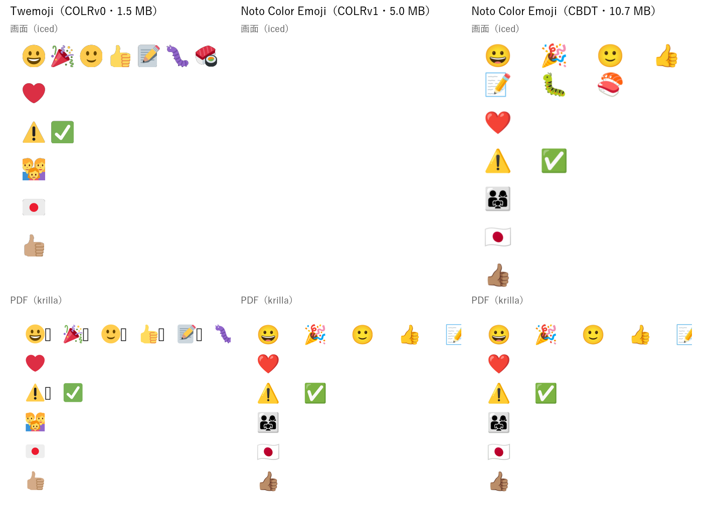

# v3.0.0 要件定義書

作成日: 2026-10-28
対象: mdview v3（v2.9.0 の次のメジャーバージョンアップ）

---

## 0. この文書の位置づけ

v3 で入れる機能を決める。**何を・どこまで作るか**を書き、作り方は§10 の経緯欄に残す。

`research/mobile-feasibility` の枝で行った次の調査から、利用者が採ったものを入れる（2026-10-27〜28）。

|調査|文書|採ったもの|
|---|---|---|
|モバイル対応の実現可能性|[v3モバイル対応の実現可能性検証](v3モバイル対応の実現可能性検証.md)|案 B（土台を共有し、PC は iced、モバイルは Dioxus の WebView）|
|モバイルの UI|[v3モバイルのUI検討](v3モバイルのUI検討.md)・[画面設計案（PPTX）](v3モバイル画面設計案.pptx)|閲覧中心＋軽い編集。ブロック単位で直す|
|PC 版の UI 改善|[v3のPC版UI改善の実現可能性検証](v3のPC版UI改善の実現可能性検証.md)|U-1〜U-4|
|類似プロジェクトの仕様から|[v3追加機能の提案](v3追加機能の提案（類似プロジェクトの仕様から）.md)|優先「高」5 件・「中」7 件|

### 0.1 版の割り振りと優先度

|版|対象|
|---|---|
|**v3.0.0**|R-01〜R-21（**3 段で作る**。§0.2）|
|将来（未定）|§5.2|

### 0.2 決めたこと

|論点|決めたこと|
|---|---|
|モバイル対応の作り（2026-10-27。調査の結論を利用者が採った）|**土台（UI に依存しない部分）をクレートに切り出して共有する。PC 版は iced のまま、モバイル版は Dioxus（端末の WebView）で別の殻を作る**。PC 版まで WebView にはしない（v1 で抜け出したメモリと 10 MB の問題に戻るため）|
|モバイルで目指す範囲（2026-10-27。利用者の選択）|**閲覧中心＋軽い編集**。WYSIWYG・10 MB の編集・MCP・比べる画面は PC 版だけ|
|モバイルの編集の入り方（2026-10-28。UI 検討）|**ブロック単位で直す**（下から出る板＋キーボードの上の道具の帯）。全文の原文は補い|
|PC 版の UI 改善（2026-10-28。利用者の求め）|U-1 OS に寄せた見た目・U-2 メニューの幅・U-3 macOS は OS のメニュー・U-4 メニューの階層化を入れる|
|追加機能（2026-10-28。利用者の選択）|類似プロジェクトの仕様からの提案の**優先「高」と「中」の 12 件**を入れる。「低」の 5 件（Mermaid の中の数式・HTML のプレビュー・Emmet・28 言語の UI・Microsoft Store）は入れない|
|元の書き方を保つ（v2.5.0 から）|ブロック単位で直すときも、表から書き換えるときも、裏では原文を書き換え、触っていない所は 1 バイトも変えない|
|切り替えられるようにする機能（v2.4.0 から）|オン・オフや動き方を変えたくなりうる機能には、設定と設定画面の欄を置く（§2）|
|手元の道具（2026-10-27。利用者の判断）|**手元に Android・iOS の道具は入れない**。モバイル向けに組めるか・macOS の動きは、公開用のリポジトリの GitHub Actions で確かめる（§6.2）|
|段取り（2026-10-28。利用者の選択）|**3 段・v3.0.0 に全部**: 段 1（R-01 土台の切り出し＋PC 版の機能 R-08〜R-20）→ 段 2（PC 版の UI R-04〜R-07）→ 段 3（モバイル版 R-02・R-03）。段ごとに目視とコミット。段 3 が長引けば、その時点で v3.1 へ回すかを相談する|
|モバイル版の配り方（2026-10-28。利用者の選択）|**Android は署名した APK を GitHub の Release に置く**（ストアは後の版）。**iOS は CI で組めることまで**確かめ、配布は見送る（Apple の開発者登録が要る）|
|iOS の画面の目視（2026-10-28。利用者の選択）|**macOS 版と同じ扱い**。iOS 版を配るときは「見た人がいない版」として配り、そのことを明記する（いまは配らないので、配ると決めたときに当てる）|
|OS に寄せた見た目の範囲（2026-10-28。利用者の選択）|**全部の部品に見た目の組を入れる**（ボタン・入力欄・チェック・選択欄・スクロールバー・トグル・メニュー・ダイアログ）。確認のダイアログを OS のものにするかは、背面へ回る不具合の対処（§10.18）を確かめてから|
|大きすぎるファイルの上限（2026-10-28。利用者の選択）|**100 MB**。超えたら読み取り専用で先頭 512 KB だけを開く。値は設定で変えられる|
|絵文字の描き方（2026-10-28。利用者の選択）|**どこでも同梱の字体で描く**（編集画面・プレビュー・WYSIWYG・PDF・PPTX・モバイル版）。どの OS でも同じ見た目にし、Windows でも国旗を出す。配る物は字体の分だけ大きくなる（約 4〜10 MB。字体による）|
|同梱する絵文字の字体（2026-10-28。利用者の選択）|**Noto Color Emoji の CBDT 版**（OFL 1.1・約 10.7 MB・Unicode 18）。画面（iced）と PDF（krilla）の両方で描けると確かめた（§0.4）。iced が COLRv1 を描けるようになったら COLRv1 版（5.0 MB）へ替える|
|マルチカーソルの「同じ語を選ぶ」の打鍵（2026-10-28。利用者の選択）|**既定の打鍵を置かない**。メニューとコマンドパレットから使い、打鍵は利用者がキー割り当てで決める。キャレットを上下に足す（`Ctrl + Alt + ↑ / ↓`）・単語を足す（`Ctrl` + ダブルクリック）は既定のまま|

### 0.3 まだ決めていないこと

無し。

### 0.4 絵文字の字体の比べ（2026-10-28。手元の Windows 11）

候補の字体を取り、本体と同じ部品で描いた: 画面は iced 0.14（試作 `poc/v3-emoji-screen`）、PDF は krilla 0.8（試作 `poc/v3-pdf-emoji`）。
行は上から、基本（😀 🎉 🙂 👍 📝 🐛 🍣）・❤️・⚠️ ✅・ZWJ の家族（👨‍👩‍👧）・国旗（🇯🇵）・肌の色（👍🏽）。

|字体|形式|大きさ|画面（iced）|PDF（krilla）|絵文字の版|使用許諾|
|---|---|---|---|---|---|---|
|Twemoji（Mozilla 版 v0.7.0）|COLRv0（絵の形）|1.5 MB|**全部描ける**|全部描ける（PDF 28 KB）。**字体に空白の字が無く、空白が □ になる**（本番は空白を本文の字体で描くので起きない見込み）|**Emoji 14（2022-10）で止まっている**。それより新しい絵文字は豆腐になる|絵は CC-BY 4.0（**表記の義務**。About・出力に載せる）|
|Noto Color Emoji|COLRv1（絵の形）|5.0 MB|**何も描かれない**（iced が COLRv1 を描けない）|全部描ける（PDF 64 KB）|新しい（2026-09。Unicode 18）|OFL 1.1|
|**Noto Color Emoji**|**CBDT（画像の字形）**|**10.7 MB**|**全部描ける**|**全部描ける**（PDF 55 KB。字形は画像として入る）|**新しい**（2026-09。Unicode 18）|**OFL 1.1**（著作権表示の一覧に載せるだけ）|

- ZWJ の家族は、Noto では灰色の人影の絵になる（字体の絵の決まり。色の画素を数える判定では「色が無い」と出たが、描けている）
- **勧めるのは Noto Color Emoji の CBDT 版**。配る物は約 10.7 MB 大きくなる（いまの同梱の字体は 22.4 MB）。字形が画像（約 136 px）なので、**大きく拡大すると少しぼやける**（見出し・スライド・表示倍率の最大）
- 画面の部品（iced）が COLRv1 を描けるようになったら、**COLRv1 版（5.0 MB・どの大きさでも鮮明）**へ替える
- 取得は、同梱の字体と同じく `tools/fetch-fonts.py` で、版（コミット）を固定し照合値で確かめる

---

## 1. 要件

### 土台とモバイル版

#### R-01. 土台をクレートに切り出す

（モバイル対応の検証 §1.2・§4。試作 `poc/v3-mobile/core` で、UI 以外の約 3.8 万行が `iced_core` の型だけで組めた）

- 解析・レイアウト・編集・出力・図・数式・文字コード・設定など、UI に依存しない部分を**別のクレート（例: `mdview-core`）**にする
- 継ぎ目の 3 か所（`render::fonts`・`render::slides`・`render::backdrop`、`render::token_color`、`app::COMMAND_RECENT_MAX`）を土台へ移す
- 土台は窓と GPU の部品（winit・wgpu）を持たない。値の型だけ `iced_core` を使う
- **PC 版の動きは変えない**（いまの単体試験・GUI 試験がそのまま通る）。土台の単体試験は土台のクレートで流す
- 土台が Android・iOS 向けに組めることを CI で確かめる（§6.2）

#### R-02. モバイル版（Android・iOS）

（モバイル対応の検証 §3、モバイルの UI 検討、画面設計案）

- **Dioxus（0.7 以降）で、端末の WebView に描く**。描く中身は土台の HTML の書き出し
- 画面: 読む面が主。上は文書名だけの帯（下へ読むと隠れる）、下に 5 つの操作（目次・検索・直す・表示・その他）。押せる所は 44 pt・48 dp 以上
- 直す: 「直す」→ ブロックを押す（または長押し）で、そのブロックの原文を下から出る板で直す。キーボードの上に道具の帯
  （取り消し・← →・見出し・箇条・作業・太字・コード・リンク・字下げ・**「完了」はいつも見える**）。直すそばから板の上のブロックを描き直す。
  大きく直すときは「その他 → 全文を直す」。読む面で作業の印 ☐ を押すと `[ ]`・`[x]` を入れ替える
- 検索: 入力は上、前へ・次へ・置換は下。目次: 下から出る板
- タブレットの横置き（幅 900 px 以上）: 目次を左に出したまま。原文とプレビューを並べて直せる
- **日本語の入力を壊さない**: 変換中は入力欄へ値を書き戻さない（`compositionstart`〜`compositionend`）。道具の帯を押しても焦点を外さない
- **ブロック単位で描き直す**（全文の HTML の書き出しは 300 KB で約 1 秒かかるため）。直したら自動で保存し、5 秒「元に戻す」を出す
- 大きい文書（例: 1 MB 超）は読むだけ（直す面に入らない）
- ファイル: 端末の書類の選択（Android の SAF・iOS の Files）から開く・保存する。PDF・HTML の出力と共有
- 画面の端からのスワイプは使わない（OS の戻る操作と取り合う）
- 配色は OS の設定に従う

#### R-03. モバイル版の組み立てと配り方

- CI で Android（APK）と iOS（シミュレーター向けの .app）を組む（`v3-mobile-poc.yml` を本番の作業の流れにする）
- **Android は署名した APK を GitHub の Release に置く**。署名の鍵は Actions の秘密（シークレット）に置き、リポジトリには置かない
- **iOS は CI で組めることまで**（配布しない）。配ると決めたら「見た人がいない版」として配る（§0.2）

### PC 版の UI

#### R-04. メニューの幅を中身に合わせる（U-2）

（PC 版の UI 改善の検証 §3.2。いまは見出し 96 px・中身 320 px の決め打ち）

- 見出しの幅は字の幅＋余白。開いた中身の幅は「名前の最大＋打鍵の最大」から決める（字の幅を測る。表示倍率が変わったら測り直す）
- 開く位置は左の見出しの幅の和

#### R-05. メニューの階層化（U-4）

（PC 版の UI 改善の検証 §3.4）

- いまの「その場で縦に広がる折りたたみ」を、**横へ開く下の階層**にする（2 段まで）
- ファイルメニューを似た操作でまとめる: 開く ▸（開く・新しいウィンドウで開く・URL を開く・アプリ内で開く）・最近使ったファイル ▸・比べる ▸（6 種）・出力 ▸（PDF・HTML・PPTX・スライド）。
  ほかのメニューのまとめ方は設計で決める
- キーボード: → で開く・← で閉じる・↑↓ で動く・Enter で押す・Esc で 1 段戻る。下の階層の中にも割り当て文字を置ける
- 斜めに動かしても閉じない（少し待って切り替える）。画面の端では反対側へ開く
- GUI 試験の要素の名前を、階層に合わせて決め直す

#### R-06. macOS では OS のメニュー（U-3）

（PC 版の UI 改善の検証 §3.3。設計 §7.2 はもともと「macOS は OS のメニュー」と決めていたが、作られていなかった）

- macOS では画面の上端のメニューバーに出し、窓の中のメニューは出さない（`muda`）
- 先頭にアプリの名前のメニュー（このアプリについて・設定…・サービス・隠す・終了）と、ウインドウメニュー
- 打鍵は `Ctrl` を `⌘` へ読み替える。**OS のメニューが打鍵を先に取るので、アプリの側で二重に扱わない**。キー割り当ての変更は OS のメニューへ反映する
- 有効・無効・印・最近使ったファイルは、状態が変わるたびに合わせる
- 割り当て文字（`ファイル(F)`）は macOS では出さない

#### R-07. OS に寄せた見た目（U-1）

（PC 版の UI 改善の検証 §3.1）

- OS ごとの**見た目の組**（字体・字の大きさ・ボタンの高さ・角・影・メニューの行の高さ・**ダイアログのボタンの並び**）を持ち、動いている OS のものを使う
- **全部の部品に入れる**: ボタン・入力欄・チェック・選択欄・スクロールバー・トグル・メニュー・ダイアログ（§0.2）
- 強調色を OS から取る（Windows は DWM の色。macOS・GNOME も取る）
- 設定で「mdview の見た目（いまの Fluent 風）」にも戻せる

### PC 版の機能（類似プロジェクトの仕様からの提案）

#### R-08. GitHub のアラート（H-1）

- `> [!NOTE]`・`[!TIP]`・`[!IMPORTANT]`・`[!WARNING]`・`[!CAUTION]` を、色と印の付いた枠で描く。プレビュー・WYSIWYG・PDF・HTML・スライドで同じ
- 色は役割で持ち、配色で解決する。モバイル版でも同じ（HTML の書き出しに入る）

#### R-09. 単語単位の検索・置換（H-2）

- 検索欄に「単語」の切り替え（`Aa`・`.*` の隣）。正規表現と組み合わせられる
- 日本語はダブルクリックの単語選択と同じ区切り方（§15.4）。10 MB でも後戻りしない照合を保つ

#### R-10. ファイルごとの位置の記憶（H-3）

- キャレット・選択・スクロール位置をファイルごとに覚え（既定 50 件）、開いたときに戻す。外で変わっていたら近い所か先頭
- 位置はブロック ID＋ブロック内の位置で持つ（§12.3）。モバイル版の「続きから読む」にも使う

#### R-11. マルチカーソル（H-4）

- キャレットを上下に足す・単語を足す・同じ語を選ぶ（次の 1 つ・全部）。打つ・消す・写す・貼るが全部のキャレットに効く。取り消しは 1 回で戻る
- 「同じ語を選ぶ」には**既定の打鍵を置かない**（メニュー・コマンドパレットから。打鍵はキー割り当てで決める。§0.2）
- いまの矩形選択は、複数の選択の特別な形として持ち直す
- 10 MB で 1 打鍵 16 ms の目標を守る。WYSIWYG・モバイル版では使わない

#### R-12. 大きすぎるファイル（H-5）

- 上限（**100 MB**。設定で変えられる）を超えるファイルは、**読み取り専用で先頭だけ**を開き、切ったことを帯で知らせる（「全部を開く」は確かめてから）
- 文字コードの判定も先頭で行う。メモリの目標（10 MB の文書で 600 MB 以下）を超えないことを試験で見る
- v2.9.0 §5.2 の「512 KB を超えるファイルの右端での折り返し・Markdown の検査」を、この要件の中で扱う（できる範囲を設計で決める）

#### R-13. `.mmd`・`.svg` を描いて開く（M-1）

- Mermaid のファイル（`.mmd`・`.mermaid`）は図として、SVG は絵としてプレビューに出す。原文は編集画面で直せる

#### R-14. 権限の要る場所への保存（M-2）

- 保存が「権限が無い」で失敗したら、OS の確かめ（Windows の UAC・macOS の認証・Linux の pkexec など）を経て保存する。断っても編集と取り消しの履歴は残す

#### R-15. 開いているファイルは、その窓を前に出す（M-3）

（2026-10-28 に確かめた: いまは 2 つ目の窓が開き、両方で別々に直せてしまう）

- 開く前に、ほかの窓（居場所の登録 `ipc::registered`）へ開いているファイルを問い合わせ、開いていればその窓を前に出して自分は開かない
- 起動の引数・関連付け・「新しいウィンドウで開く」・最近使ったファイルのどれでも効く。同じ窓の中の「開く」も同じ

#### R-16. 打鍵の一覧（`F1`。M-4）

- いまの窓で効く打鍵を一覧で重ねて出す（キー割り当ての変更を反映。コマンドパレットと同じ並び）

#### R-17. 選ばずに行ごと切り取る・写す（M-5）

- 選択が無いときの `Ctrl + X`・`Ctrl + C` を行ごとにし、行ごとに写したものは行の頭に貼る。設定で切れる

#### R-18. ジャンプリスト・Dock のメニュー（M-6）

- タスクバー（Windows）・Dock（macOS）の右クリックに最近使ったファイル。Linux は .desktop の動作（できる範囲）

#### R-19. カラー絵文字（M-7）

（2026-10-28 に確かめた: 画面は OS の字体で色が出るが、PDF は豆腐。追加機能の提案 §2.4）

- **絵文字の字体を同梱し、どこでもそれで描く**（編集画面・プレビュー・WYSIWYG・PDF・PPTX・モバイル版。§0.2）。OS の絵文字の字体には頼らない
- 字体は **Noto Color Emoji の CBDT 版**（§0.2）。選んだ条件（§0.4）:
  - 再配布できる使用許諾（著作権表示の一覧 `assets/licenses` に載せる。表記の義務があれば About と出力に従う）
  - **画面の部品（iced）が色で描ける形式**（いまの画面は COLRv0 の字体を色で描けている。COLRv1・CBDT は確かめが要る）
  - **PDF の部品（krilla）が描ける形式**（COLRv0・COLRv1・SVG・画像の字形を扱える）
  - 国旗・ZWJ の連なり・肌の色を含む。絵文字の版（Unicode の版）が新しい
  - 大きさ（配る物が大きくなる分）
- 字体は同梱の字体と同じく取得の道具（`tools/fetch-fonts.py`）で取り、照合値で確かめる（リポジトリには置かない）
- PDF・PPTX には使った字だけを埋め込む（いまの字体と同じ）
- **ZWJ でつないだ絵文字の中は、怪しい文字の印を付けない**（👨‍👩‍👧 の後ろに赤い印が出る）
- ⚠️ など**異体字の印（U+FE0F）付きは絵文字の字体で描く**（いまは本文の字体の字の形で出る）。U+FE0E（字の形の印）付きは字の形のまま

#### R-20. 調査の残り

- 試作で見つかった、本番でも気を付けること（iced の重ね合わせは下の層の大きさで上の層を切る、など。PC 版の UI 改善の検証 §2.2）を設計に入れる

#### R-21. 実機での確認で見つかった不具合

- 受入確認チェックリスト U・CI の結果・モバイルの実機の目視で見つかった不具合（あれば）

---

## 2. 設定ファイルに足す項目と設定画面

`settings.toml` に足す。**読めない値は既定値**にする（いまと同じ）。名前と細かい値は設計で決める。
**どの項目も設定画面から変えられ、項目ごとに「既定」に戻せる**（v2.1.0 R-03 と同じ）。

|機能|項目|既定|設定画面の分類|
|---|---|---|---|
|見た目（R-07）|OS に寄せた見た目か、mdview の見た目か|OS に寄せる|外観|
|アラート（R-08）|GitHub のアラートを描くか|描く|プレビュー|
|位置の記憶（R-10）|ファイルごとの位置を覚えるか・覚える件数|覚える・50 件|ファイル|
|大きすぎるファイル（R-12）|先頭だけ開く上限・先頭の大きさ|100 MB・512 KB|ファイル|
|`.mmd`・`.svg`（R-13）|図・絵として開くか|開く|プレビュー|
|開いている窓（R-15）|開いていれば前に出すか|出す|ファイル|
|行ごとの切り取り（R-17）|選ばずに行ごと切り取る・写すか|する|エディタ|
|絵文字（R-19）|同梱の絵文字の字体で描くか、OS の字体に任せるか（配った先で OS の見た目に合わせたい人のため）|同梱の字体|外観|

モバイル版の設定（字の大きさ・配色・大きい文書の上限）は、段 3 の最初に決める。

---

## 3. 打鍵の割り当て（既定の案）

キー割り当ての変更（v2.1.0 R-10）の対象にする。macOS では `Ctrl` を `⌘` に読み替える（R-06）。

|操作|打鍵|
|---|---|
|キャレットを上・下に足す（R-11）|`Ctrl + Alt + ↑` / `Ctrl + Alt + ↓`|
|単語を足す（R-11）|`Ctrl` + ダブルクリック|
|同じ語を選ぶ（次の 1 つ・全部。R-11）|（**既定は無し**。キー割り当てで決める）|
|打鍵の一覧（R-16）|`F1`|
|検索の「単語」の切り替え（R-09）|`Alt + W`（検索欄の中で）|

---

## 4. 対象外（v3.0.0 では入れない）

v2.9.0 の要件定義書 §4 と同じ。加えて、類似プロジェクトの仕様からの提案の「低」（Mermaid の中の数式・HTML のプレビュー・Emmet・28 言語の UI・Microsoft Store）、
モバイル版の WYSIWYG・10 MB の編集・MCP・比べる画面・マルチカーソル、Dioxus Native（Blitz）での描画は入れない。

---

## 5. 後の版に回したもの

### 5.1 v3.0.0 で入れきれなかったときの扱い

R ごとに区切りがつくので、入れきれないものはその時点で利用者と相談して次の版へ回す。**モバイル版（R-02・R-03）は、段 3 が長引くなら v3.1 に分ける**。

### 5.2 将来（未定。記録だけ）

|機能|中身|
|---|---|
|英語の UI|公開の範囲を広げるなら。文言を外へ出す作業が大きい|
|モバイル版のストア配布|Google Play・App Store。署名と審査|
|Mermaid の中の数式|描く部品（merman）の側の対応を待つ|

---

## 6. 受け入れの確かめ方

### 6.1 手元で確かめること

単体試験と GUI 試験（`tools/automation/spec_test.py`）の項目を足し、受入確認チェックリストに目視の節（V）を足す。

- 土台の切り出し（R-01）は、**切り出す前と後で単体試験・GUI 試験が同じに通る**ことで確かめる
- マルチカーソル（R-11）・大きすぎるファイル（R-12）は、10 MB・100 MB 超の文書で速さとメモリを測る（`spec_test.py --perf`）
- 開いている窓（R-15）・絵文字（R-19）は、2026-10-28 の確かめ方（試験用の操作口で起こし、窓の数・本文・画面と PDF の絵を見る）を GUI 試験にする

締めに **release で組み、煙試験と `spec_test.py --perf`** を流す。

### 6.2 CI（公開用のリポジトリの GitHub Actions）で確かめること

本体のリポジトリは非公開で、Actions が支払いの都合で起動しない。**公開用の一式（`research-v3/`）を公開用のリポジトリに置いて流す**。

|作業の流れ|確かめること|対象|状態（2026-10-28）|
|---|---|---|---|
|`v3-mobile-poc.yml`|土台・iced・Dioxus の試作が Android（APK）・iOS（シミュレーター）向けに組めるか（R-01・R-02・R-03）|Android・iOS|1 回目は試作の誤りで落ちた（直した）。**2 回目は未実施**|
|`v3-desktop-ui-poc.yml`|macOS で OS のメニューを組めるか。画面の上端に出るか（R-06）|macOS|**未実施**|
|`v3-pdf-emoji-poc.yml`|絵文字の字体で PDF に色で描けるか（R-19）。**同梱に決めたので、字体の形式ごとの確かめに使う**（OS の字体: Windows は COLR・macOS は sbix・Linux は CBDT）。同梱の候補は手元で比べた（§0.4）|Windows・macOS・Linux|手元の Windows（COLR・候補 3 つ）では描けた。**CI は未実施**（同梱に決めたので、判断には要らない。OS の字体に任せる設定の確かめに使う）|

**モバイルの実機**（日本語の変換・キーボードの上の帯・長押し・片手の操作）は CI では見られない。試作（`poc/v3-mobile/mock/`）を端末で開いて確かめる。

---

## 変更管理

|版数|日付|変更内容|
|---|---|---|
|v0.5|2026-10-28|同梱する絵文字の字体を利用者が決めた: Noto Color Emoji の CBDT 版（§0.2）。まだ決めていないことは無くなった|
|v0.4|2026-10-28|同梱する絵文字の字体の候補 3 つ（Twemoji COLRv0・Noto COLRv1・Noto CBDT）を、画面（iced）と PDF（krilla）で描いて比べた（§0.4）。勧めるのは Noto Color Emoji の CBDT 版|
|v0.3|2026-10-28|絵文字の描き方を利用者が決めた: **どこでも同梱の字体**（§0.2）。R-19 を同梱の字体の要件に書き直し、字体の選び方の条件と候補（Noto Color Emoji・Twemoji）を §0.3 に置いた|
|v0.2|2026-10-28|§0.3 の 7 つのうち 6 つを利用者が決めた（3 段・Android は APK と iOS は組むまで・iOS の目視は macOS 版と同じ扱い・見た目の組は全部の部品・上限 100 MB・同じ語を選ぶは既定の打鍵無し）。絵文字の描き方は、利用者が編集画面・プレビューも含めて考え直す|
|v0.1|2026-10-28|`research/mobile-feasibility` の調査から作った。モバイル対応（案 B）・モバイルの UI・PC 版の UI 改善（U-1〜U-4）・追加機能（高と中の 12 件）を R-01〜R-21 にまとめた。段取り・配り方・U-1 の範囲・上限の値・打鍵・PDF の絵文字の方法は §0.3 に残した|
