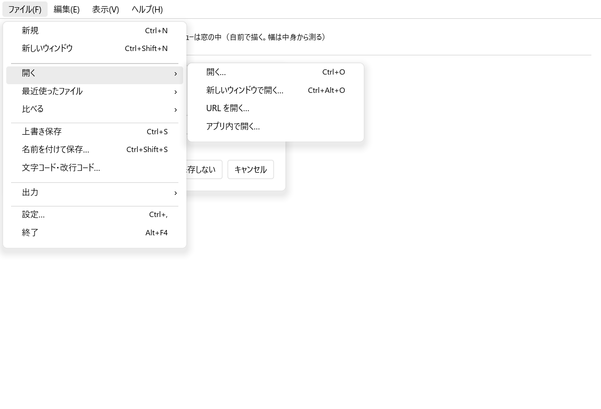
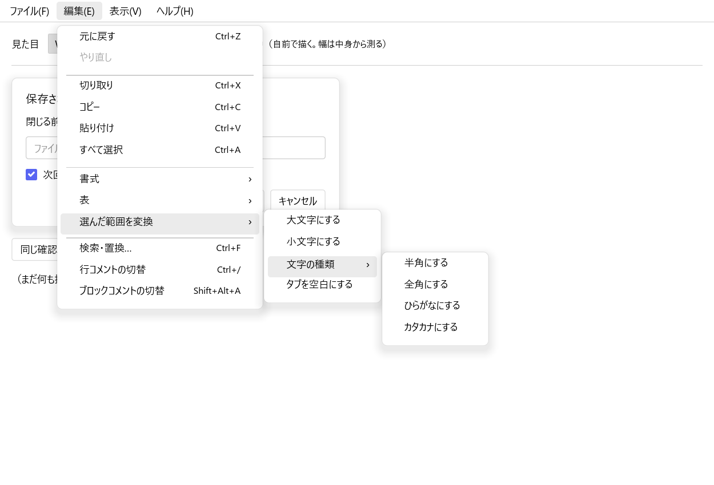
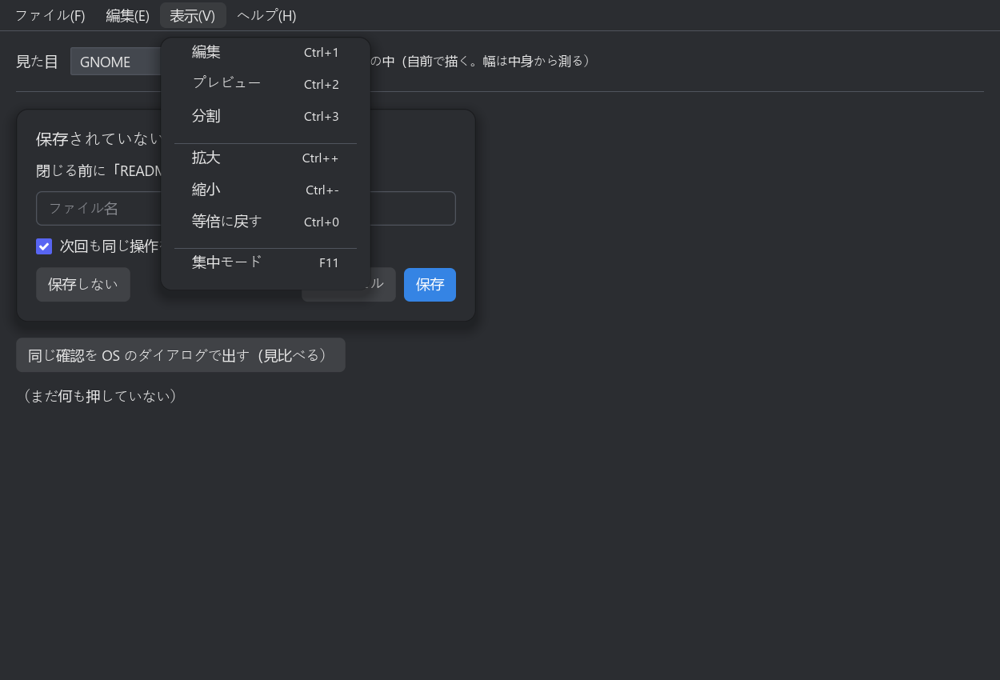

# v3 PC 版の UI 改善の実現可能性検証

作成日: 2026-10-28
対象: mdview v3（メジャーバージョンアップ）での PC 版（Windows・macOS・Linux）の UI の改善
ブランチ: `research/mobile-feasibility`（調査用。モバイル対応の検証と同じ枝）
関連: [v3 モバイル対応の実現可能性検証](v3モバイル対応の実現可能性検証.md)

---

## 0. この文書の位置づけ

利用者が挙げた次の要件を、v3 で入れられるかを**作りの分析と試作**で確かめた記録。v3 の要件定義書ではない。

|#|要件（利用者の言葉から）|
|---|---|
|U-1|ボタン・入力欄・ダイアログなどの UI 部品を、**OS 標準の見た目に寄せる**|
|U-2|メインメニューの**項目の横幅を調整する**|
|U-3|**macOS では、メニューを窓の中ではなく OS 標準の位置（画面の上端）に置く**|
|U-4|「開く」など**似た操作を下の階層にまとめる**（階層化）|

### 0.1 結論（要約）

|#|できるか|作る量|要点|
|---|---|---|---|
|U-1|**寄せられる（OS の部品そのものにはならない）**|中〜大|iced は部品を自分で描く。寸法・字体・角・影・強調色・ボタンの並びを OS ごとに変える「見た目の組」で寄せる。確認のダイアログは OS のものにも替えられる|
|U-2|**できる**|小|本体は幅を決め打ち（見出し 96 px・中身 320 px）。字の幅を測って決めれば、中身に合う（試作で確かめた）|
|U-3|**できる見込み**|中|`muda`（Tauri の部品）で macOS の `NSMenu` を組む。型検査と clippy は通った。**起動して画面の上端に出るかは、CI で確かめる**（§3.3）|
|U-4|**できる**|中|本体の「その場で縦に広がる折りたたみ」を、**横へ開く下の階層**に替える。試作で 2 段まで開けた。キーボードでの操作と画面の端での折り返しは作る必要がある|

U-2 と U-4 は自前のメニューの中の話で、**どの OS でも同じ作りで直せる**。U-3 は macOS だけ別の作り（OS のメニュー）になる。

---

## 1. いまの作り（v2.9.0）

|もの|作り|場所|
|---|---|---|
|メニュー|**すべての OS で窓の中に自前で描く**。設計（§7.2）は「macOS は OS のメニュー」と決めていたが、**作られていない**|`src/app/menu.rs`（並びと有効・無効）・`src/app/mod.rs` の `chrome`・`dropdown`|
|メニューの幅|見出しは 1 つ 96 px、開いた中身は 320 px の**決め打ち**（打鍵の併記 `Shift + Alt + A` が 1 行に入る幅）|`MENU_WIDTH`・`MENU_PANEL_WIDTH`|
|下の階層|「最近使ったファイル ▸」などは、押すと**その場で縦に広がる**（折りたたみ）。横へは開かない|`menu::expand`・`Submenu`|
|ファイルメニュー|1 段目に約 25 項目（開く 4 種・比べる 6 種・出力 4 種が並ぶ）|`menu::items`|
|部品の見た目|Fluent Design に寄せた 1 つの組（角・縁・影・ホバー）。**どの OS でも同じ**|`src/app/fluent.rs`|
|ダイアログ|ファイルの選択は **OS のもの**（`rfd`）。確認・設定・文字コード・出力は**自前**|`src/app/picker.rs` ほか|

メニューを自前で描く理由は、v1（WebView）で起きた「Windows でメニューのアクセラレータが発火しない」を構造的に避けるため（§7.2）。
**Windows・Linux は自前のまま**にし、この判断は変えない。

---

## 2. 試作（`poc/v3-desktop-ui/`）

本体と同じ iced 0.14 で、本体の自前のメニューに**そのまま持ち込める形**で作った。本体の組み立てには入らない。

|ファイル|中身|
|---|---|
|`src/model.rs`|メニューの中身。本体の並びを**似た操作でまとめ直した案**（§4.4）。自前のメニューと OS のメニューで共有する|
|`src/main.rs`|自前のメニュー（幅を測る・横へ開く下の階層）・確認のダイアログの見本・見た目の切り替え。`POC_SHOT_DIR` で窓を PNG に撮る|
|`src/look.rs`|OS に寄せた見た目の組（Windows 11・macOS・GNOME）。Windows の強調色は OS から取る|
|`src/native_menu.rs`|macOS の OS のメニュー（`muda`）|
|`.github/workflows/v3-desktop-ui-poc.yml`|macOS で組んで起動し、窓の写真と画面全体の写真を成果物に残す|

### 2.1 手元（Windows）で確かめたこと

|確認|結果|
|---|---|
|組む・単体試験（2 件）・clippy（`-D warnings`）|通った|
|macOS 向けの型検査と clippy（`aarch64-apple-darwin`。`muda` を含む）|**通った**（リンクと動きは CI で見る）|
|窓の写真（`POC_SHOT_DIR`。5 場面）|撮れた。下に 3 枚|

**ファイル → 開く**（Windows 11 の見た目。幅は中身から測った）



**編集 → 選んだ範囲を変換 → 文字の種類**（2 段の下の階層）



**表示**（GNOME の見た目・暗い配色。ダイアログの主な操作「保存」が右端）



### 2.2 試作で踏んだこと（本番でも気を付ける）

- **iced の重ね合わせ（`stack`）は、いちばん下の層の大きさで上の層を切る。** 本文が窓より短いと、長いメニューの下の方が消えた。
  下の層を窓いっぱいに広げて直した
- **場面を変えたのと同じ刻みで窓を撮ると、描き終わる前の画面になる。** 刻みを分けて撮った
- 別の OS の字体（macOS の見た目の「ヒラギノ角ゴシック」）は、入っていない OS では代わりの字体になる。見た目の組を見比べるときは注意する

---

## 3. 要件ごとの検討

### 3.1 U-1 OS 標準の見た目に寄せる

**iced は OS の部品を使わず、自分で描く**（10 MB の編集とプレビューを自前で描くために選んだ。§6）。そのため、
OS の部品と**同じ物**にはならない。次の 3 つで寄せる。

|寄せ方|中身|試作|
|---|---|---|
|**見た目の組を OS ごとに持つ**|字体（Windows: Yu Gothic UI・macOS: ヒラギノ角ゴシック・GNOME: Noto Sans CJK JP）・字の大きさ（14・13・14 px）・ボタンの高さ（32・24・34 px）・角（4・6・6 px）・パネルの角と影・メニューの行の高さ・**ダイアログのボタンの並び**（Windows は主な操作が左、macOS・GNOME は右端）|`look.rs`。切り替えて見比べられる|
|**OS の強調色を使う**|Windows は DWM の色（`DwmGetColorizationColor`）。macOS は `NSColor.controlAccentColor`、GNOME は設定の `accent-color`（どちらも別の口が要る）|Windows だけ取った|
|**ダイアログを OS のものにする**|確認（保存しますか・上書きしますか）は `rfd` の `MessageDialog` で出せる。**ただし本体は「背面へ回る」不具合を踏んでいる**（§10.18。親の窓を渡し、UI の糸を止めない対処が要る。ファイルの選択と同じ）|ボタン 1 つで見比べられる|

**残る差と懸念**

- **全部の部品に見た目の組が要る。** 試作はボタン・入力欄・メニュー・パネルだけで、チェックの印は iced の既定の色（紫）のまま残った（写真）。
  本体には選択欄・スクロールバー・トグル・スライダー・タブ・一覧もある
- アニメーション（開くときの動き）・Windows の Acrylic の質感・ハイコントラストの配色・**スクリーンリーダー（UI Automation など）**は、
  自前で描く限り OS と同じにはならない。v3 で触れるかは要件で決める
- OS の部品そのものを使う作り（Windows は WinUI、macOS は AppKit、Linux は GTK）は、**UI を 3 つ書く**ことになる。勧めない
- 設定・文字コード・出力のダイアログは中身が多く、OS の部品では作れない。自前のまま見た目の組で寄せる

### 3.2 U-2 メニューの横幅

**決め打ちをやめ、字の幅を測って決める。** 本体はすでに、窓が無くても字の幅を測る口を持っている（`render/measure.rs`。描画役の値は要らず、
iced の `Paragraph` の型だけで測れる）。試作は同じ口で次のように決めた。

- 見出しの幅 = 「ファイル(F)」の字の幅 + 左右の余白
- 開いた中身の幅 = 印の列 + 名前の最大 + 間（32 px）+ 打鍵の最大 + ▸ の列 + 余白
- 中身を開く位置 = 左の見出しの幅の和（決め打ちの `index × 96` をやめる）

写真では、表示メニューは約 210 px、ファイルメニューは約 305 px になった（本体はどれも 320 px）。**作る量は小さい**。
字の大きさ（表示倍率）が変わると幅も変わるので、測った値は倍率ごとに作り直す。

### 3.3 U-3 macOS のメニューを画面の上端に

**`muda`（Tauri の部品。0.21）で `NSMenu` を組む。** 試作は次のように作った。

- 中身は自前のメニューと**同じ並び**から作る。下の階層は OS の下の階層になる
- macOS の作法で、**先頭にアプリの名前のメニュー**（このアプリについて・設定…・サービス・隠す・終了）と、**ウインドウ**メニューを足す。
  「設定…」「終了」「このアプリについて…」はアプリの名前のメニューへ移す
- 打鍵は `Ctrl` を `⌘` へ読み替える（`CmdOrCtrl`）
- 押されたものは `MenuEvent` で届くので、iced の購読で 50 ms ごとに受け取る
- 組むのは、アプリ（`NSApplication`）ができてから（iced の最初の `update`）

**本番での注意**

|注意|対処の案|
|---|---|
|**OS のメニューが打鍵を先に取る**|macOS ではアプリの側で同じ打鍵を扱わない（二重に動く）。キー割り当ての変更（v2.1.0 R-10）は、OS のメニューの打鍵を作り直して反映する|
|有効・無効・印（● など）の同期|本体の `menu::Context`（いまの状態）が変わるたびに `set_enabled`・`CheckMenuItem` で合わせる|
|最近使ったファイル|開くたびに下の階層を作り直す|
|割り当て文字（`ファイル(F)`）|macOS では出さない（作法に無い）|
|編集メニューの切り取り・コピー・貼り付け|OS の入力欄（ダイアログ）でも効くよう、OS の決まった項目（`PredefinedMenuItem`）を使うか決める|
|**誰も macOS の画面を見ていない**|CI で起動して画面全体を撮る（`v3-desktop-ui-poc.yml`）。最終の確認は Mac を持つ人の目視が要る|

設計（§7.2）はもともと「macOS は OS のメニュー」と決めていたので、**設計の判断は変えずに、作られていなかったものを作る**ことになる。

### 3.4 U-4 下の階層にまとめる

**横へ開く下の階層にする。** 試作は、▸ の行に乗るか押すと、右に次の段が開く（親の行の高さから）。2 段まで開けた（編集 → 選んだ範囲を変換 → 文字の種類）。

まとめ方の案（試作の `model.rs`）。**ファイルメニューの 1 段目は約 25 項目から 11 項目になる。**

```text
ファイル(F)
 ├ 新規 / 新しいウィンドウ
 ├ 開く ▸          開く… / 新しいウィンドウで開く… / URL を開く… / アプリ内で開く…
 ├ 最近使ったファイル ▸
 ├ 比べる ▸        ファイルを比べる… / アプリ内で選んで比べる… / 保存してある元と比べる / ─ / フォルダーを比べる… / 3 つのファイルをマージする… / パッチを当てる…
 ├ 上書き保存 / 名前を付けて保存… / 文字コード・改行コード…
 ├ 出力 ▸          PDF / HTML / PPTX（スライド） / スライドを書き出す
 └ 設定… / 終了
```

**作る必要があるもの**（試作には無い）

|もの|中身|
|---|---|
|キーボードでの操作|→ で下の階層を開く・← で閉じる・↑↓ で行を動く・Enter で押す・Esc で 1 段戻る|
|割り当て文字|下の階層の中にも置けるようにする（いまは「数が変わる並びには置かない」決まり。§7.2）|
|斜めに動かしたときに閉じない|親の行から下の階層へ斜めに動くと、途中の行に触れて閉じる。少し待ってから切り替える（いわゆる menu aim）|
|画面の端での折り返し|右端・下端で、反対側へ開く・上へずらす|
|コマンドパレット・キー割り当ての一覧|まとめた名前（「開く」「比べる」）を、一覧の分類にも使うか決める|
|GUI 試験|要素の名前（`menu.file.open` など）を階層に合わせて決め直す（`tools/automation`）|

---

## 4. 次の段取り

1. **CI で macOS を流す**（`v3-desktop-ui-poc.yml`。公開用のリポジトリで）。「OS のメニューを組んだ」が記録に出るか、画面全体の写真に
   上端のメニューバー（mdview・ファイル・編集・表示・ヘルプ・ウインドウ）が写るかを見る
2. **試作を目視**する（`target\v3core\debug\mdview-desktop-ui-poc.exe`）。見た目を 3 つの OS で切り替え、メニューを開いて乗って動かす
3. v3 の要件で決めること
   - U-1 をどこまで寄せるか（見た目の組を全部の部品に入れるか、ダイアログを OS のものにするか、スクリーンリーダーに触れるか）
   - U-4 のまとめ方（§3.4 の案でよいか）
4. 作る順の案: **U-2（小）→ U-4（中）→ U-3（中。macOS）→ U-1（中〜大）**。U-2 と U-4 は自前のメニューの作り直しで一緒にできる

---

## 変更管理

|版数|日付|変更内容|
|---|---|---|
|v0.1|2026-10-28|初版。U-1〜U-4 の検討と試作（`poc/v3-desktop-ui`）。macOS の CI は未実施|
