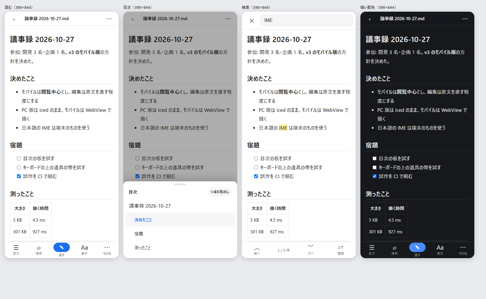
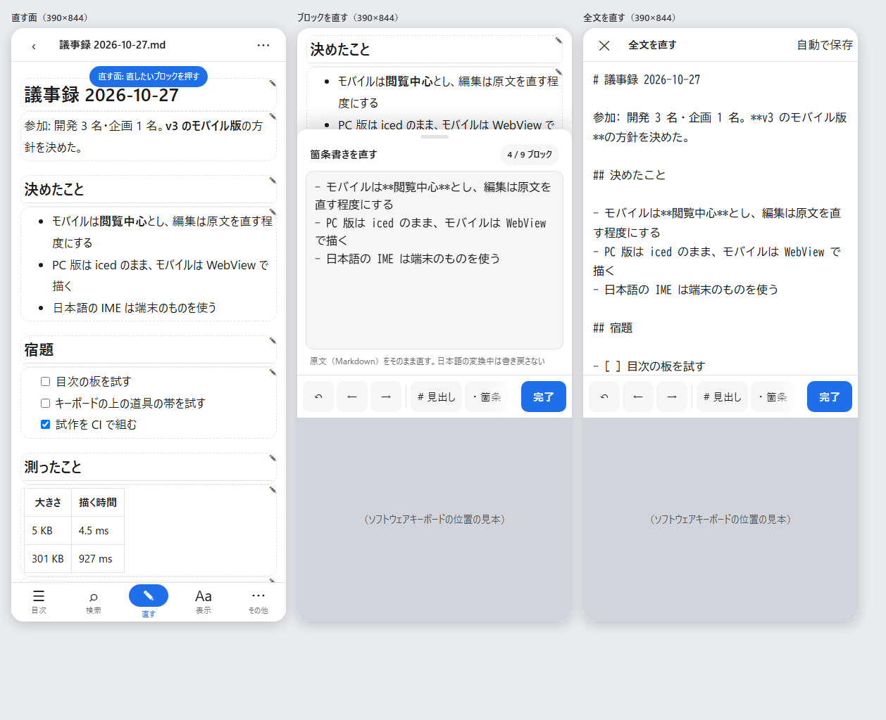
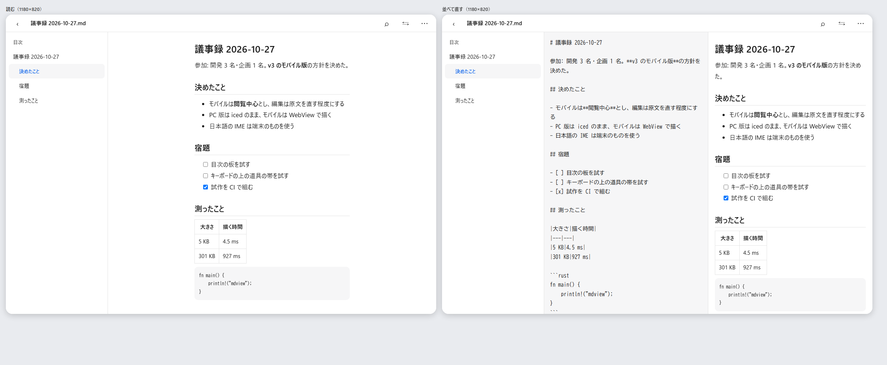

# v3 モバイルの UI 検討

作成日: 2026-10-28
対象: mdview v3 のスマートフォン・タブレット版の画面と操作
ブランチ: `research/mobile-feasibility`
関連: [v3 モバイル対応の実現可能性検証](v3モバイル対応の実現可能性検証.md)（作り。勧める案は土台を共有し、モバイルは Dioxus の WebView で描く案 B）

---

## 0. この文書の位置づけ

**閲覧の操作性を下げすぎず、最低限の編集もストレスなくできる**モバイルの UI を検討した記録。調べたこと・案・試作（HTML）・試作で確かめたことを書く。
v3 の要件定義書ではない。範囲は「閲覧中心＋軽い編集」（利用者の選択。2026-10-27）。

### 0.1 結論（要約）

|論点|案|
|---|---|
|画面の骨組み|**読む面が主**。上は文書名だけの細い帯（下へ読むと隠れる）、**下に 5 つの操作**（目次・検索・**直す**・表示・その他）。主な操作は親指の届く下に置く|
|編集の入り方|**ブロック単位で直す**（勧める）。「直す」を押すか、ブロックを長押しすると、そのブロックの原文が**下から出る板**に入る。直すそばから、板の上のブロックが描き直される。構造を大きく変えるときだけ「全文を直す」|
|キーボード|**キーボードの上に道具の帯**（取り消し・← →・見出し・箇条・作業・太字・コード・リンク・字下げ）。**「完了」はいつも右端に見える**。帯を押してもキーボードは閉じない|
|日本語の入力|**変換中は入力欄の値を書き戻さない**（書き戻すと変換中の字が消える）。**いまの Dioxus の試作はこの危険がある**ので直す（§4.1）|
|タブレット|横置き（幅 900 px 以上）は**目次を左に出したまま**。直すときは**原文とプレビューを並べる**。外付けキーボードでは PC 版と同じ打鍵|
|試作|`poc/v3-mobile/mock/index.html`（端末のブラウザーでそのまま動く）。手元の Edge で端末の大きさに組んで撮り、見つかった崩れを直した（§5）|

---

## 1. 何を「ストレスなく」とするか

### 1.1 モバイルで想定する使い方

|場面|例|頻度の見込み|
|---|---|---|
|読む|会議の前に資料を読む・移動中に設計メモを見返す|いちばん多い|
|探す|見出しへ飛ぶ・言葉で探す|多い|
|ちょっと直す|誤字・1 行の追記・**作業の印（☐→☑）**・表の値・見出しの言い回し|ときどき|
|大きく直す|節の入れ替え・長い文章の書き足し|まれ（PC 版でやる）|

### 1.2 目標

|目標|決め方|
|---|---|
|押しやすい|押せる所は **44 pt（Apple）・48 dp（Google）以上**。主な操作は画面の**下の 3 分の 1**（親指の届く所）|
|すぐ直し始められる|読んでいる所から **2 回押すまでに**入力できる（「直す」→ ブロック、または長押し 1 回）|
|日本語の変換を壊さない|変換中の字が消えない・確定が二重にならない（§4.1）|
|直したらすぐ見える|直すそばから、そのブロックの描き方が変わる（プレビューへ切り替えない）|
|失わない・戻せる|自動で保存し、直したあと 5 秒「元に戻す」を出す。文書の取り消しの履歴にも積む|
|読む面を狭めない|上の帯は下へ読むと隠れる。下の帯は 56 px だけ|

---

## 2. 編集の入り方の比較

|案|中身|よい所|困る所|判断|
|---|---|---|---|---|
|A. 全文の原文|文書全体を 1 つの入力欄で直す（いまの Dioxus の試作）|作りが簡単。何でも直せる|**どこを直しているか見失う**（読んでいた所と原文の位置が離れる）。長い文書で入力欄が重い。直した結果は切り替えないと見えない|**B の補い**（「その他 → 全文を直す」）|
|**B. ブロック単位**|押したブロック（段落・箇条・表・コード）の原文だけを、下から出る板で直す|**読んでいた所のまま直せる**。入力欄が小さく軽い。直すそばから板の上のブロックが描き直される。土台の「ブロック単位の描き方」（モバイル対応の検証 §5.2）と同じ単位|ブロックをまたぐ直し（2 つの段落をつなぐなど）は A に回す|**勧める**|
|C. 描いたまま直す（WYSIWYG）|WebView の `contenteditable` で、描いた面をそのまま直す|見た目のまま直せる|**日本語の変換と `contenteditable` の相性が悪い**（端末ごとに動きが違う）。原文への写し戻しを作り直すことになり、元の書き方を保てない（v2.5.0 からの決まり）|採らない|
|D. PC 版と同じ自前の編集器|iced の編集器をモバイルへ持ち込む|PC 版と同じ動き|Android で日本語の変換中の字が来ない（モバイル対応の検証 §2.2）|採らない|

**B のついでにできる最小の編集**: 読む面で**作業の印（☐）を押すと、原文の `[ ]` と `[x]` を入れ替える**（入力欄を開かない）。いちばん多い「ちょっと直す」を 1 回で済ませる（試作には未実装）。

---

## 3. 画面の案

試作（`poc/v3-mobile/mock/`）を、手元の Edge で端末の大きさの枠に入れて撮ったもの。キーボードは位置の見本（灰色）。

### 3.1 スマートフォン（390×844）: 読む・目次・検索・暗い配色

- **読む**: 上は「‹（ファイル）・文書名・⋯」だけ。下に 5 つ。本文は 17 px・行の高さ 1.8
- **目次**: 下から出る板。いまの見出しに色を付ける。押すと飛んで閉じる
- **検索**: 入力は上（キーボードと近い）、**前へ・次へ・置換は下**（親指で送る）。当たった所に色
- **暗い配色**: OS の設定に従う

### 3.2 スマートフォン: 直す

- **直す面**: 「直す」を押すと、ブロックの境目が点線で見え、上に「直したいブロックを押す」の札が出る
- **ブロックを直す**: 押したブロックが上へ送られ、その原文が下の板に入る。板の名前でブロックの種類が分かる（箇条書きを直す・表を直す…）。
  キーボードの上の道具の帯は、左から**取り消し・← →（キャレットを 1 字動かす。指で狙うのは難しい）・見出し・箇条・作業・太字・コード・リンク・字下げ**。
  帯は横に流せ、**「完了」は流れる部分の外にいつも出す**
- **全文を直す**: 「その他」から。窓いっぱいの原文と同じ道具の帯

### 3.3 タブレットの横置き（1180×820）: 読む・並べて直す

- 幅 900 px 以上は**目次を左に出したまま**にし、下の帯は出さない（操作は上の帯へ）
- 「並べて直す」で**原文とプレビューを並べる**（原文を直すとプレビューが追う）。外付けキーボードでは PC 版と同じ打鍵を使う

### 3.4 操作の決まり

|決まり|理由|
|---|---|
|**画面の端からのスワイプを使わない**|Android・iOS の「戻る」の操作と取り合う。目次はボタンと下の板で出す|
|長押しは「このブロックを直す」|**ただし OS の文字の選択（長押し）と取り合う見込み**。実機で確かめ、取り合うなら「2 回続けて押す」に替える（§6）|
|板は下に引くと閉じる・上に引くと広がる|片手で扱える。板の高さを 2 段（半分・ほぼ全部）にする（試作は固定）|
|直したら自動で保存し、「元に戻す」を 5 秒出す|保存の手間と失う心配を両方なくす|
|大きい文書（例: 1 MB 超）は直す面に入らない|描き直しの重さ（モバイル対応の検証 §5.1）。読むだけにする|

---

## 4. 技術上の決まり（本番の作りへ持ち込む）

### 4.1 日本語の変換を壊さない

- **入力欄に値を書き戻さない**（入力欄を「自分で値を持つもの」にし、アプリは読むだけ）。変換中に値を書き戻すと、変換中の字が消える
- `compositionstart` から `compositionend` までは描き直さない。`input` は `isComposing` が真なら無視し、`compositionend` で 1 回だけ反映する
- **いまの Dioxus の試作（`dioxus-app/src/main.rs`）は `textarea { value: "{text}", oninput: … }` で、打つたびに値を書き戻す**。
  WebView の実機で変換が壊れる見込みが高いので、上の決まりに直す
- Enter で何かを決める所（検索欄など）は、変換の確定の Enter と取り違えない（`isComposing` を見る）

### 4.2 キーボードと道具の帯

- 表示域の決まり: `<meta name="viewport" content="…, viewport-fit=cover, interactive-widget=resizes-content">`（Android の Chrome・WebView でキーボードの分だけ中身を縮める）
- **iOS は CSS でキーボードの高さを取れない**ので、`visualViewport` の `resize`・`scroll` で高さを受け、板と帯をその上へ置く（試作の `fitKeyboard`）
- Android 15 の端まで描く決まり（edge-to-edge）では、窓が自動で縮まらない。**WebView にキーボードの分の余白（insets）を渡す**作りを、殻の側（Dioxus の起動）で確かめる
- 道具の帯は **`pointerdown` で既定の動きを止める**（止めないと入力欄から焦点が外れ、キーボードが閉じる。他の編集器で報告が多い）
- 画面の切り欠き・ホームのバーは `env(safe-area-inset-*)` で避ける

### 4.3 ブロック単位で直す作り

- 土台の解析が持つ**ブロックの原文の範囲**で原文を差し替え、そのブロックだけ HTML を作り直して入れ替える（全文の HTML の書き出しは 300 KB で約 1 秒かかる。モバイル対応の検証 §5.1）
- 取り消しは**文書の履歴**（土台の `edit`）に積む。入力欄の中の取り消しは、板を開いている間だけ
- 直したブロックが別の種類になったとき（段落の頭に `# ` を足して見出しになった）は、前後のブロックを読み直して目次も直す

---

## 5. 試作（`poc/v3-mobile/mock/`）

|ファイル|中身|
|---|---|
|`index.html`|画面の試作 1 枚（HTML・CSS・JS）。**端末のブラウザーでそのまま開ける**。状態は URL の `#`（`#read`・`#toc`・`#search`・`#edit`・`#block`・`#full`・`#split`）、`?kbd=1` でキーボードの位置の見本、`?theme=dark` で暗い配色|
|`gallery.html`|`index.html` を端末の大きさの枠に並べる（`?f=#read,#toc&w=390&h=844`）。撮影と見比べに使う|

描き方は見本（簡単な Markdown の変換）で、本番は土台の HTML をブロックごとに使う。

### 5.1 撮って見つけ、直したこと

手元の Edge のヘッドレスで撮り（`gallery.html` を大きい窓で開き、端末の大きさは枠で作る）、写真を見て直した。

|見つけたこと|直し|
|---|---|
|直す面の印が上の帯に入り、文書名が切れた|上の帯の下に札として出す|
|道具の帯が横に流れ、**「完了」が画面の外に出た**|「完了」を流れる部分の外に置く|
|ブロックを直す板の入力欄が 3 行しかなかった|キーボードの上の残りの高さまで広げる|
|短い文書だと、直すブロックが板の陰に隠れた|板を開いている間は本文の下に余白を足し、ブロックを上へ送れるようにする|
|検索の前後の移動が画面の上にあった（指が届きにくい）|下の帯に移した|
|タブレットで上の帯のボタンが出なかった（CSS の決まりの順）|隠す決まりを先に書く|

**撮り方の注意**: Edge のヘッドレスは窓に最小の幅があり、390 px を指定しても広く組んでから切り取る（そのため最初の写真は崩れて見えた）。
窓を大きくし、端末の大きさは iframe で作る。また、ヘッドレスの Edge はたまに止まる（同じ場面で通ったり止まったりした）ので、撮り直す。

---

## 6. まだ確かめていないこと・次の段取り

**実機でしか分からないこと**（試作の写真では見られない）

1. 日本語の変換（Gboard・iOS の日本語キーボード）で、ブロックの板と全文の板の入力が壊れないか
2. キーボードを出し入れしたときに、板と道具の帯がキーボードの上に付いてくるか（`visualViewport`）。道具の帯を押してもキーボードが閉じないか
3. **長押しが OS の文字の選択と取り合わないか**（取り合うなら 2 回続けて押す、に替える）
4. 片手で下の帯・板・道具の帯に届くか。押し間違いが無いか
5. タブレットの横置き・縦置きの切り替え、外付けキーボードの打鍵

**段取りの案**

1. 試作を端末で開く。公開用のリポジトリで GitHub Pages を使うと、URL を端末で開くだけで試せる（`research-v3/poc/v3-mobile/mock/`。使うかは利用者の判断）。
   または、ファイルを端末へ送ってブラウザーで開く
2. 実機で見た結果で案を直し、**Dioxus の試作へ取り込む**（§4.1 の入力欄の直しを最初に）。CI の APK で同じことを確かめる
3. v3 の要件で、モバイルで直せる範囲（ブロック単位・作業の印・全文）と、上限の大きさを決める

---

## 7. 出典

- キーボードの上の道具の帯（`visualViewport`）: <https://github.com/michael/svedit/pull/352>、<https://github.com/michael/svedit/pull/349>、
  BlockNote のモバイルの帯（押すと焦点が外れる報告）<https://github.com/TypeCellOS/BlockNote/pull/1284>、<https://github.com/do-md/domd/pull/11>
- Markdown の道具の帯の要望（Obsidian・Joplin）: <https://forum.obsidian.md/t/feature-soft-keyboard-enhanced-to-support-markdown/55420>、<https://discourse.joplinapp.org/t/mobile-markdown-toolbar/26089?page=2>
- 変換中の書き戻しと入力: <https://dev.classmethod.jp/en/articles/react-ime-composition-pitfalls/>、<https://developer.squareup.com/blog/understanding-composition-browser-events/>、
  <https://bugs.webkit.org/show_bug.cgi?id=46868>
- 表示域とキーボード: <https://developer.chrome.com/blog/viewport-resize-behavior>、<https://developer.android.com/develop/ui/views/layout/webapps/understand-window-insets?hl=en>、
  <https://htmhell.dev/adventcalendar/2024/4/>
- 押せる大きさ・親指の届く所: <https://blog.openreplay.com/improving-tap-targets-mobile-ux/>、<https://www.uxpin.com/studio/blog/responsive-design-touch-devices-key-considerations/>

---

## 変更管理

|版数|日付|変更内容|
|---|---|---|
|v0.1|2026-10-28|初版。目標・編集の入り方の比較（ブロック単位を勧める）・画面の案・技術上の決まり・HTML の試作と撮って直したこと|
