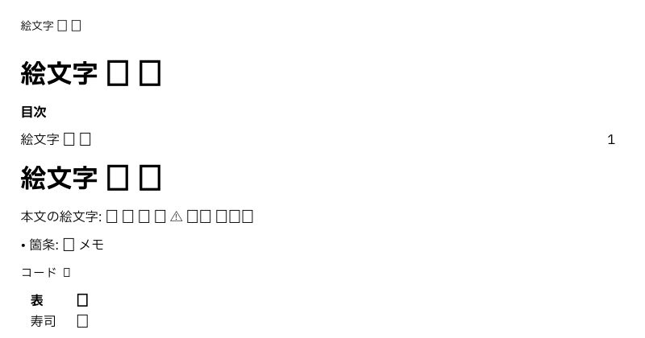

# v3 追加機能の提案（類似プロジェクトの仕様から）

作成日: 2026-10-28
対象: mdview v3（メジャーバージョンアップ）で取り入れる機能の候補
ブランチ: `research/mobile-feasibility`

---

## 0. この文書の位置づけ

利用者の求め（2026-10-28）で、類似のテキストエディタ **miu**（<https://github.com/kenjinote/miu>。MIT）の**仕様**を参考に、
v3 で取り入れる機能を提案する。**参照したのは README とリリースノート（v1.0.11〜v1.0.40）だけで、ソースコードは見ていない。**
mdview は独立したリポジトリで、作りは mdview の設計に従って一から考える。

### 0.1 miu の要点（仕様から）

|項目|中身|
|---|---|
|位置づけ|「次世代テキストエディタ」。速さ・簡素・安定を重んじる|
|対応する OS|Windows 11 / 10・macOS・**iOS・iPadOS**|
|特色|巨大なファイルの高速な編集（メモリマップド）・カラー絵文字・**マルチカーソル**・矩形選択・**単語単位の検索／置換**・無制限の取り消し・`F1` の打鍵の一覧・28 言語の UI|
|最近の版（2026-10）|Markdown・HTML・SVG の分割プレビュー、Mermaid の 33 種の図、**数式（Mermaid の中も）**、GitHub の**アラート**（NOTE ほか 5 種）、Emmet、**ファイルごとのキャレット・選択・スクロール位置の記憶**、**管理者の権限が要る場所への保存**、ジャンプリスト|

### 0.2 決めたこと（2026-10-28。利用者の判断）

|論点|決めたこと|
|---|---|
|採る範囲|**優先「高」の 5 件（H-1〜H-5）と「中」の 7 件（M-1〜M-7）を v3 に採る**。「低」の 5 件は採らない|
|要確認の 2 件|確かめた（§2.4）。M-3（すでに開いているファイル）は**無い**と確かめた。M-7（カラー絵文字）は**画面は色で出るが、PDF は豆腐になる**など 3 つの直しが要る|

### 0.3 結論（要約）

v3 で**入れることを勧める**もの（§2 の優先「高」）:

1. **GitHub のアラート**（`> [!NOTE]` など 5 種）。プレビュー・PDF・HTML で描く。作る量は小さく、GitHub と見た目がそろう
2. **単語単位の検索・置換**。検索欄の切り替えを 1 つ足すだけ
3. **ファイルごとのキャレット・選択・スクロール位置の記憶**。開き直すと続きから読める（モバイルの「読む」にも効く）
4. **マルチカーソル**（複数の場所に同時に打つ）。作る量は大きいが、メジャーバージョンアップの目玉になる
5. **大きすぎるファイルを安全に開く**（読み取り専用で先頭だけ見せる）。10 MB を超えるファイルの扱いを決める

---

## 1. 突き合わせ（miu の機能 × mdview のいま）

|# |miu の機能（仕様の言葉）|mdview v2.9.0|差|
|---|---|---|---|
|1|マルチカーソル（`Ctrl + Alt + ↑↓`、`Ctrl` + ダブルクリックで単語を足す、同時に打つ・写す）|矩形選択だけ|**無い**|
|2|単語単位での検索／置換|正規表現・大文字小文字の区別だけ|**無い**|
|3|キャレット・選択・スクロール位置を 32 ファイル分覚え、開いたときに戻す|窓の位置は覚える。ファイルごとの位置は覚えない|**無い**|
|4|GitHub のアラート（NOTE・TIP・IMPORTANT・WARNING・CAUTION）|描かない（引用として出る）|**無い**|
|5|巨大なファイル（1 GB 超）は先頭 512 KB だけを安全にプレビューし、切ったことを知らせる|10 MB を目安に作り、超えたら知らせて続ける（上限で拒まない）|扱いが**決まっていない**|
|6|Mermaid のファイル（`.mmd`・`.mermaid`）を図として開く・SVG のプレビュー|Markdown の中の Mermaid だけ。`.mmd`・`.svg` は文字として開く|**無い**|
|7|数式を Mermaid の節・辺・題の中でも描く|Mermaid の HTML ラベルを切っているので描かない（§7.3）|**無い**（作りの制約）|
|8|管理者の権限が要る場所への保存（UAC。断っても編集と取り消しの履歴を保つ）|保存できないと知らせるだけ|**無い**|
|9|タスクバーのジャンプリストに最近使ったファイル|メニューの「最近使ったファイル」だけ|**無い**|
|10|すでに開いているファイルを開くと、その窓を前に出す|**無い**（2 つ目の窓が開き、両方で別々に直せてしまう。§2.4 で確かめた）|**無い**|
|11|`F1` で打鍵の一覧を出す|キー割り当ての一覧は設定画面・コマンドパレット|形が**違う**|
|12|選ばずに行ごと切り取る・写す・貼る|行の複製・削除・連結はある|**一部無い**|
|13|カラー絵文字|**画面は色で出る。PDF は豆腐（□）**。ZWJ に怪しい文字の印が付く（§2.4 で確かめた）|**一部無い**|
|14|28 言語の UI|日本語だけ（多言語対応は対象外と決めている。§3.2）|方針で**外している**|
|15|Emmet（HTML・CSS の略記の展開）|無い|**無い**（Markdown の用途には合わない）|
|16|HTML の分割プレビュー（WebView2）|HTML は描かない（決まったタグだけ。v2.9.0）|方針で**外している**|
|17|Microsoft Store での配布|GitHub の Release だけ|**無い**|
|—|正規表現・大文字小文字・無制限の取り消し・矩形選択・括弧の対応・常に最前面・ダーク・Mica・行へ移動・右クリックのメニュー・外での書き換えの知らせ|**ある**|—|

---

## 2. 提案

**大きさ**: 小＝数日、中＝1 版の中の 1 項目、大＝1 版の主な項目。
**優先**: 高＝v3 に入れる、中＝v3 か v3.x で入れる、低＝入れない（理由を書く）。

### 2.1 優先「高」（**採用**）

|提案|中身|作り（mdview の設計に沿って）|大きさ|
|---|---|---|---|
|**H-1 GitHub のアラート**|`> [!NOTE]`・`[!TIP]`・`[!IMPORTANT]`・`[!WARNING]`・`[!CAUTION]` を、色と印の付いた枠で描く。プレビュー・WYSIWYG・PDF・HTML の書き出し・スライドで同じ|引用のブロックの頭の 1 行を見て種類を決める（解析は comrak の拡張か自前。ブロック単位の解析に乗る）。色は役割で持ち、配色で解決する（いまの決まり）|小|
|**H-2 単語単位の検索・置換**|検索欄に「単語」の切り替え（`Aa`・`.*` の隣）。正規表現と組み合わせられる|英数字は `\b` 相当、**日本語は単語の区切り（ダブルクリックの単語選択と同じ決まり。§15.4）**で判定する。10 MB でも後戻りしない照合を保つ|小|
|**H-3 位置の記憶**|ファイルごとにキャレット・選択・スクロール位置を覚え（例: 50 件）、開いたときに戻す。ファイルが外で変わっていたら、近い所へ戻すか先頭にする|位置は**ブロック ID ＋ブロック内の位置**で持つ（スクロール位置の保存と同じ考え方。§12.3）。設定で切れる。**モバイル版でも「続きから読む」に使う**|小〜中|
|**H-4 マルチカーソル**|`Ctrl + Alt + ↑↓` でキャレットを上下に足す・`Ctrl` + ダブルクリックで単語を足す・「同じ語を次も選ぶ」（`Ctrl + D` は行の複製に使っているので別の打鍵）。打つ・消す・写す・貼るが全部のキャレットに効く。取り消しは 1 回で戻る|編集器の「選択」を 1 つから**並び**へ広げる（矩形選択は並びの特別な形として持ち直す）。10 MB での速さ（1 打鍵 16 ms）を試験で守る。WYSIWYG では使わない|**大**|
|**H-5 大きすぎるファイル**|上限（例: 100 MB）を超えるファイルは、**読み取り専用で先頭だけ**を開き、切ったことを帯で知らせる（「全部を開く」は確かめてから）。文字コードの判定も先頭で行う|いまの「知らせて続ける」を、上限を境に分ける。メモリの目標（10 MB で 600 MB 以下）を超えないことを試験で見る。**512 KB を超えるファイルの右端の折り返し・Markdown の検査**（v2.9.0 §5.2 の将来）と一緒に、大きいファイルの扱いとして 1 つの要件にまとめる|中|

### 2.2 優先「中」（**採用**）

|提案|中身|大きさ|
|---|---|---|
|**M-1 `.mmd`・`.svg` を描いて開く**|Mermaid のファイルは図として、SVG は絵としてプレビューに出す（どちらも描く部品はもう入っている: merman・resvg）。原文は編集画面で直せる|小|
|**M-2 権限の要る場所への保存**|保存が「権限が無い」で失敗したら、OS の確認（Windows の UAC・macOS の認証）を経て保存する。断っても編集と取り消しの履歴は残す|中（OS ごと）|
|**M-3 すでに開いているファイルは、その窓を前に出す**|同じファイルを 2 つの窓で開いて食い違うのを防ぐ。開く前に、ほかの窓（居場所の登録 `ipc::registered`）へ開いているファイルを問い合わせ、開いていればその窓を前に出して自分は開かない（起動の引数・関連付け・「新しいウィンドウで開く」・最近使ったファイルのどれでも）|小〜中|
|**M-4 打鍵の一覧（`F1`）**|いまの窓で効く打鍵を一覧で重ねて出す（キー割り当ての変更を反映）。コマンドパレットと同じ並びを使う|小|
|**M-5 選ばずに行ごと切り取る・写す**|選択が無いときの `Ctrl + X`・`Ctrl + C` を行ごとにする（VS Code と同じ）。設定で切れる|小|
|**M-6 ジャンプリスト・Dock のメニュー**|タスクバー（Windows）・Dock（macOS）の右クリックに最近使ったファイル|中|
|**M-7 カラー絵文字**|確かめた結果（§2.4）から 3 つを直す: ① **PDF で絵文字を描く**（いまは豆腐。絵文字の字体を埋めるか、絵として描く。同梱すると配る物が大きくなるので、OS の絵文字の字体を出力のときに使う案を先に検討する）② **ZWJ の連なりの中は怪しい文字の印を付けない**（👨‍👩‍👧 の後ろに赤い印が出る）③ ⚠️ など**異体字の印（U+FE0F）付きを絵文字の字体で描く**（いまは字の形で出る）。国旗は Windows の絵文字の字体に無いので「JP」の字のまま（OS の制約。記録だけ）|中|

### 2.3 優先「低」（採らない）

|機能|入れない理由|
|---|---|
|Mermaid の中の数式|Mermaid の HTML ラベルを切っている（§7.3。HTML ラベルは黙って欠ける）。描く部品（merman）の側の対応を待つ|
|HTML の分割プレビュー|HTML を描かないのが v2 の方針（安全性・WebView を持たない）。決まったタグだけ描く（v2.9.0）を続ける|
|Emmet|HTML・CSS を書く道具で、Markdown の文書には合わない|
|28 言語の UI|多言語対応は対象外と決めている（§3.2）。v3 で公開の範囲を広げるなら、**英語の UI だけ**を別の要件として検討する（文言を外へ出す作業が大きい）|
|Microsoft Store|配る物は Actions で組む決まり（手元で組むとユーザー名が埋まる）。Store の署名と審査の手間に見合うかを、配り方の要件で検討する|

### 2.4 要確認の 2 件を確かめた結果（2026-10-28。v2.9.0 の release で組んだもの・Windows 11）

確かめ方: 試験用の操作口（`--automation`。`tools/automation/mdview_driver.py`）で mdview を起こして操作し、画面を撮る・PDF に出力する。

**M-3 すでに開いているファイル**

- 同じファイルを指して 2 回起動すると、**窓が 2 つになる**（どちらも生きている）。2 つ目で行を足しても 1 つ目は知らない
  （1 つ目の本文は `# 同じファイル`、2 つ目は `2 つ目で足した` ＋ `# 同じファイル`）。**保存の順によっては片方の直しが消える**
- コードでも確かめた: 「新しいウィンドウで開く」は別のプロセスを起こすだけで、ほかの窓が開いているかを見ない（`app/window.rs` の `spawn_window`）。
  起動のときにも見ていない。ただし、窓は自分の居場所を登録していて（`ipc::registered`）、窓どうしで問い合わせる通り道もあるので、**作る部品はそろっている**

**M-7 カラー絵文字**

編集画面（左）とプレビュー（右）。絵文字は色で出る（OS の絵文字の字体に任せている）。

PDF。**絵文字はどれも豆腐（□）**になる。埋め込まれた字体は同梱の 3 つ（IBM Plex Sans JP・同 Bold・PlemolJP）だけで、絵文字の字体が無い。

家族の絵文字（👨‍👩‍👧。人を ZWJ でつないだもの）の後ろの赤い印。**怪しい文字の強調を切ると消える**ので、ZWJ が怪しい文字として印を付けられている。

|怪しい文字の強調: 入（既定）|切|
|---|---|
|||

ほかに気づいたこと: ⚠️ は編集画面・プレビューとも色の無い字の形で出る（本文の字体が ⚠ を持っているため、絵文字の字体まで探さないと見ている。推定）。
🇯🇵 は「JP」の字になる（Windows の絵文字の字体に国旗が無い。OS の制約）。HTML の書き出しはブラウザーが描くので、ここでは確かめていない。

---

## 3. モバイル対応との関係

- miu は **iOS・iPadOS** にも対応している（仕様から。作りは見ていない）。mdview のモバイルの方針（土台を共有し、画面は端末の WebView。
  [モバイル対応の実現可能性検証](v3モバイル対応の実現可能性検証.md)）は変えないが、**iPad で PC 版に近い編集を求められる**ことは見込んでおく
- H-3（位置の記憶）は**モバイル版の「続きから読む」**にそのまま使える。H-1（アラート）は HTML の書き出しにも入るので、モバイル版の描き方にも効く
- H-4（マルチカーソル）と M-5 は PC 版だけ（モバイルは「閲覧中心＋軽い編集」）

---

## 4. 次の段取り

1. ~~この提案から v3 に入れるものを利用者が選ぶ~~（2026-10-28。高と中の 12 件を採用）
2. 採用した 12 件を、モバイル対応・PC 版の UI 改善（[検証](v3のPC版UI改善の実現可能性検証.md)）と合わせて **v3 の要件定義書**にまとめる
3. ~~要確認の項目（§1 の 10・13）を、いまの mdview で先に確かめる~~（2026-10-28。§2.4）

---

## 5. 出典

- miu の README: <https://github.com/kenjinote/miu>
- miu のリリースノート: <https://github.com/kenjinote/miu/releases>（1〜3 ページ。v1.0.11〜v1.0.40）

---

## 変更管理

|版数|日付|変更内容|
|---|---|---|
|v0.2|2026-10-28|利用者が高と中の 12 件を採用した（§0.2）。要確認の 2 件を確かめ、M-3 は無いこと、M-7 は画面は色で出るが PDF は豆腐・ZWJ に怪しい文字の印・⚠️ が字の形と分かり、M-7 の中身を 3 つの直しにした（§2.4）|
|v0.1|2026-10-28|初版。miu の仕様（README・リリースノート）との突き合わせと、v3 の追加機能の提案（高 5・中 7・低 5）|
